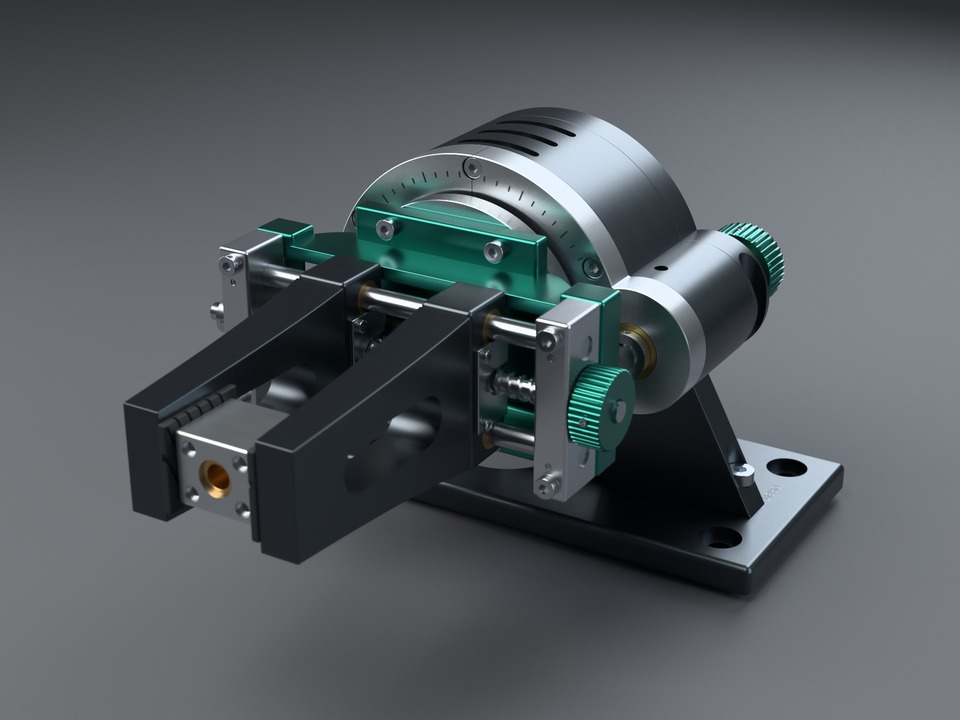
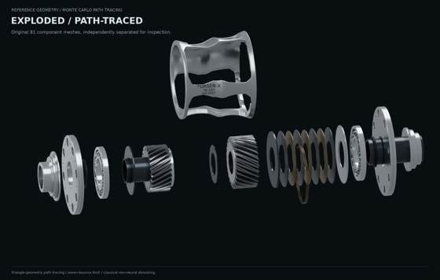

# CYBR GEO

**Procedural CAD, mechanical assemblies and geometry-driven rendering.**

One parametric recipe produces named parts, analytic solids, inspection views, motion, drawings and renderable geometry. Built in Python with CadQuery/OpenCascade, with an in-house C++ photographic path tracer and a separate Mitsuba/OIDN rendering backend.

**One reusable engineering architecture, with ARX and IRIS as examples.** Native
construction, physical materials, CAD mass/inertia, mating geometry, contacts,
electrical drives, springs, brakes and MuJoCo feed the existing assembly and
rendering API. The default ARX belt example directly reuses its published source
and transfers an independent puck through simulated contact. Examples supply
designs and tasks; construction, control and replay services are shared.
The dynamic ARX client targets the pinned P5 belt source. The latest inspected
Refined/P6B source also feeds shared native-part, joint and gear construction;
its static geometry and print prototypes retain separate evidence from the
belt dynamics.
The new [four-bar lift](examples/engineering/fourbar_lift/README.md) uses the same
services to lift a CAD-derived load through passive links driven by one motor.
[Architecture and evidence](docs/CONSTRUCTIVE_MECHANISMS.md) ·
[Author a mechanism](docs/CONSTRUCTIVE_MECHANISMS.md#author-another-project).


*Fresh native CAD posed by integrated body states. Puck motion comes from contact,
not an attachment or animation path. [Motion evidence and limits](docs/pr-assets/arx-faults/MEDIA.md).
The IRIS example uses a new single-motor, nine-link adaptation of its source
geometry. Both use the same engineering services; hardware is unqualified.*

[IRIS motion, native CAD and causal controls](docs/pr-assets/iris-engineering/README.md)
show the same pipeline driving nine passive leaves from one motor.
[Refined/P6B construction and native evidence](docs/pr-assets/arx-latest/README.md)
show actual selected BREP geometry and six print-first test articles through
the shared part, joint and gear services.



*ORBIT: 148 components, geared wrist, opposed-screw gripper, hollow palm and removable housing.* [Recipe](examples/orbit_inspection_wrist.py) · [Service sequence](docs/ORBIT_SERVICE.md) · [Geometry coverage](docs/ORBIT_SHOWCASE.md)

## Selected work

| Project | Engineering focus | Source |
| --- | --- | --- |
| **ORBIT** | Analytic assemblies, gearing, motion and a 331-operation service sequence | [Wrist recipe](examples/orbit_inspection_wrist.py) |
| **ROAM** | Seven workshop mechanisms and an articulated mobile workstation | [Workshop](examples/roam/README.md) |
| **Nitinol actuator** | Twelve SMA fibers, guided carriage and explicit electrical routing | [Actuator recipe](src/mechanism_lab/models/nitinol_actuator.py) |
| **Motor / belt drive** | Procedural motor construction, pulley/belt geometry and mechanical integration | [Motor](src/mechanism_lab/models/motor.py) · [Drivetrain](src/mechanism_lab/models/drivetrain.py) |
| **Differential** | Internal inspection, exploded views and prescribed differential kinematics | [Study](examples/differential/README.md) |
| **CYBR YARD** | A 1,404-part parametric skatepark, timber framing and outdoor rendering | [Recipe](examples/diy_skatepark/recipe.py) |



## Run it

Use the [Windows, Linux and macOS setup guide](docs/PLATFORMS.md) for platform
prerequisites and supported backends. Linux CI covers Python **3.11-3.13**;
the Windows x64 and Apple Silicon matrix uses **3.12**. On Ubuntu:

```bash
sudo apt-get update
sudo apt-get install -y g++ cmake ffmpeg libcairo2 libegl1 libgl1 libopengl0 libglib2.0-0
git clone https://github.com/cybrdelic/cybr-geo.git
cd cybr-geo
python3 -m venv .venv
source .venv/bin/activate
python -m pip install -r requirements-tested.txt
python -m pip install --no-deps --no-build-isolation -e .
lab mechanism --step --media
```

`lab mechanism` builds the actual ARX belt example through shared services and
runs its 18.05-second causal contact task. **`outputs/arx_belt/`** contains native
and placed STEP, GLB, material/mass records, editable physical source, motor
results, simulation traces and actual rendered PNG/GIF views. Allow several
minutes for initial construction. Ratings and material properties remain
explicit assumptions; complete ARX motion-envelope and hardware qualification
are not established by this run.

This first run needs no reference archive, downloaded HDRI or denoiser. Rendering
needs a supported graphics context. `lab preview --step` chooses the native
path tracer when its toolchain works, or the actual VTK geometry renderer when
that toolchain is unavailable. It defaults to `arx_belt` and writes
`outputs/arx_belt/preview/`; its receipt records the selected backend.
Use `lab preview example_flange` for the previous quick static example.

```bash
lab mechanism arx_belt --step --media
lab mechanism iris09 --step --media
lab mechanism fourbar_lift --step --out outputs/fourbar_lift
lab replay arx_belt --run outputs/arx_belt --out outputs/arx-film
lab replay iris09 --run outputs/iris09 --out outputs/iris-film --elevation 67 --no-floor
lab replay fourbar_lift --run outputs/fourbar_lift --out outputs/fourbar-film
lab animate arx_belt --seconds 18.05
lab mechanism examples/constructed/compact_arm.json --step --media
lab preview nitinol_fiber_actuator --spp 64
lab preview examples/custom_flange.py --step
lab build nitinol_fiber_actuator --step --stl
lab animate nitinol_fiber_actuator --seconds 6
lab blueprint nitinol_fiber_actuator
```

These commands create diagnostic CAD, simulation and media. `--step` and
`--stl` export inspectable geometry, not manufacturing-approved parts. The
normal engineering run also writes `design-envelope.json`. It binds measured
native STEP gaps to their required service gaps, simulated torque demand to
the source motor limits, and modeled MuJoCo connector reactions to every-step
coverage. The IRIS and four-bar clients additionally use the same planar
closure service for full-range branch bounds and CAD-mass gravity demand.
`nominal_fit.status="unresolved"` means at least one CAD gap has no allocated
design variation budget; a passing torque screen is only a source-model result. The
drive screen requires both belt and gear demand-limit telemetry: a controller
that clipped requested torque fails its source-model screen even when the
delivered peak stays at the declared limit. Missing telemetry is unresolved.
For planar projects, default generation also reopens the complete verified
native STEP inventory and records full-range axial separation for cross-body
pairs in `design-envelope.json`. It lists every overlapping or close pair as
unresolved; the continuous-clearance field remains unresolved until those
pairs have their own motion and mating evidence. Inspect both
`engineering.json` and `design-envelope.json` before using a diagnostic design.
For a qualified release, the opposed rack drive has its own source output
torque limit and requested-output clipping history; missing or clipped rack
telemetry is rejected independently of the six rotary belt/gear screens.

From a source checkout, after building `fourbar_lift`, check one moving native pair over
the entire ideal crank revolution with the common STEP envelope service:

```python
from pathlib import Path
from mechanism_lab.engineering_source import load_project, verify_native_build

run = Path('outputs/fourbar_lift')
project, sources = load_project('fourbar_lift')
native = run / 'native'
receipt = verify_native_build(native, project.specification, source_files=sources)
path = project.planar_path(project.specification, sources)
result = path.certify_native(native, receipt, clearance_pairs=[
    ('crank__crank_shaft_link_and_pin', 'rocker__rocker_shaft_link_and_pin')])
assert result['passed']
print(result['clearance_pairs'], result['unexamined_cross_body_pairs'])
```

This checks only the listed pair on its authored ideal rigid path; the receipt
counts every unexamined pair. ARX's recorded contact motion and unsampled
MuJoCo states need their own explicitly scoped checks. No example currently
has a complete, production-toleranced moving-assembly clearance certificate.

For IRIS, the default engineering envelope already runs that axial broad
phase. To write its report separately, use:

```sh
python -m examples.analysis.iris09_axial_broadphase --native outputs/iris09/native --output outputs/iris09/axial-broadphase.json
```

The receipt names every unresolved overlapping or close slab. Those pairs
still need an exact swept-solid check or a declared mating/contact model;
axial separation alone does not establish production tolerance clearance.

The ARX gripper client uses the same native interval checker on its actual
source XML slide range and STEP parts:

```sh
python examples/analysis/arx_belt_gripper_envelope.py --native outputs/arx_belt/native --output outputs/arx_belt/gripper-native-full-range.json
```

Its receipt covers six selected gripper components and all 12 cross-body
noncontact pairs among them across the nominal 10–40 mm synchronized travel.
It records the other 374 native placements as omitted. The puck contacts,
pinion/rack mesh and guide fits require their own evidence, and this check
does not establish clearance for the moving arm or the integrated MuJoCo
trajectory.

The qualified product path is `lab release PROJECT --run RUN --evidence EVIDENCE
--trust-policy POLICY --out NEW_DIRECTORY`. It requires a construction policy
enforced before CAD placement, exact source/native/model/controller/runtime
binding, independently signed supplier and process records, measured part and
interface results, load tests and an assembled hardware test. Missing or stale
records fail before a release directory is created. Current examples lack
those physical records and cannot be released as qualified hardware. See the
[manufacturing release contract](docs/MANUFACTURING-RELEASE.md).
For a model with `connect` or `weld` equalities, the qualification plan must
also map each named solver connector to a planned interface; release compares
its complete modeled reaction history with that interface's declared demand.

[Shared ARX, IRIS and four-bar films](docs/pr-assets/shared-engineering/README.md)
show the same construction, simulation and replay services at the pinned
engineering source revision. They demonstrate recorded motion and native CAD;
the release gate above still blocks hardware qualification without physical
evidence.

`lab replay` renders accepted engineering traces at 1920x1080, 24 fps and 2x
supersampling. It records actual shared-code execution, input and output hashes,
graphics backend and frame sampling in `media.json`. It uses saved integrated
states; it does not synthesize motion between samples.

For the full photographic workflow, `lab render`, `lab video` and `lab film` use V9 by default. That backend uses Mitsuba, OIDN and downloaded CC0 studio assets; see [rendering setup](docs/SHARED_PHOTOGRAPHY.md). Select `--renderer photoreal` for the in-house native tracer or `--renderer pbr` for the raster preview. [More commands and reference preparation](docs/GETTING_STARTED.md).

## How it works

| System | Implementation |
| --- | --- |
| Geometry contract | [`Assembly`, `Part`, `Material`, `View`](src/mechanism_lab/core.py); named components and rigid poses |
| Engineering source | [Project protocol](src/mechanism_lab/engineering_source.py), [native construction](src/mechanism_lab/native_construction.py), [CSG DAG](src/mechanism_lab/shape_dag.py), [physical tree](src/mechanism_lab/physical_model.py) |
| Causal engineering execution | [Shared pipeline](src/mechanism_lab/engineering_pipeline.py), [electromechanical kernels](src/mechanism_lab/actuation.py), [MuJoCo runtime](src/mechanism_lab/causal_runtime.py), [recorded replay](src/mechanism_lab/physical_replay.py) |
| Passive mechanism construction | [Pinned links](src/mechanism_lab/linkages.py), [native CAD replay](src/mechanism_lab/native_replay.py), [IRIS client](examples/engineering/iris09/README.md) |
| Source-bound mechanism budgets | [Planar closure](src/mechanism_lab/planar_linkage.py), [native rigid-path interval clearance](src/mechanism_lab/native_pose_envelope.py), [planar native adapter](src/mechanism_lab/planar_native_envelope.py), [fit/load screens](src/mechanism_lab/design_envelope.py) |
| Source-aware manufacturing geometry | [Native part resolver](src/mechanism_lab/part_geometry.py), [coupled tube/splice interfaces](src/mechanism_lab/manufacturing_joints.py), [involute pinion/rack](src/mechanism_lab/manufacturing_gears.py), [Refined/P6B clients](examples/engineering/arx_compact/README.md) |
| Manufacturing release boundary | [Construction policy, signed evidence and release gate](src/mechanism_lab/qualification.py); [contract](docs/MANUFACTURING-RELEASE.md) |
| Component document compatibility | [Component compiler](src/mechanism_lab/construction.py), [continuous path clearance](src/mechanism_lab/motion_envelope.py), [Studio](studio/README.md) |
| Parametric construction | [CAD helpers](src/mechanism_lab/geometry.py), [advanced geometry](src/mechanism_lab/advanced_geometry.py), [recipes](src/mechanism_lab/models) |
| Reusable pipeline | [Recipe registry and cache](src/mechanism_lab/registry.py), [one-command preview](src/mechanism_lab/preview.py) |
| Native photography | [Thin-lens BVH/GGX/MIS tracer](src/mechanism_lab/native/photoreal.cpp), [Python adapter](src/mechanism_lab/photoreal.py) |
| CAD and interchange | [STEP, STL, GLB and animated glTF](src/mechanism_lab/exporters.py); explicit mm/Z-up → m/Y-up conversion |
| Drawings | [OpenCascade hidden-line projection and vector drawing export](src/mechanism_lab/whiteprint.py) |
| Assembly motion | [Service process and clearance checks](src/mechanism_lab/assembly_process.py) |

Recipes define the object; shared code handles its outputs. Geometry validation runs during recipe creation and its report is retained with the cache. Source, declared recipe dependencies and retained input changes invalidate that cache. The original `cybrgeo` CLI/API remains available alongside `lab`.

## Development

```bash
make test-core       # independent geometry / rendering contracts
make test-mechanisms # shared construction, kinematics, cache and Studio routes
make preview         # real CAD → GLB / STEP → native image
make test            # complete suite; see prerequisite notes below
```

[Quickstart CI](.github/workflows/quickstart.yml) exercises the documented install and preview on Python 3.11–3.13. The [complete regression workflow](.github/workflows/recovery-regressions.yml) regenerates the differential inputs before running the full suite. Historical release-output tests can skip when their archives are absent; [test scope and setup](docs/GETTING_STARTED.md#tests) explains the distinction.

## Scope and license

The shared core supports native CAD, rendering, kinematic studies and explicitly scoped MuJoCo dynamics. Physical load capacity, fatigue, production fits and hardware qualification remain separate work. Vendor CAD is identified where used; conceptual internals and original geometry retain their provenance. [Sources](docs/MOTOR_SOURCES.md) · [Compatibility](docs/COMPATIBILITY.md) · [Publication inventory](docs/PUBLICATION_INVENTORY.md) · [Architecture](docs/ARCHITECTURE.md).

GPL-2.0-only for project code. Third-party assets retain their own rights. Created by [Alejandro Figueroa / cybrdelic](https://github.com/cybrdelic).
