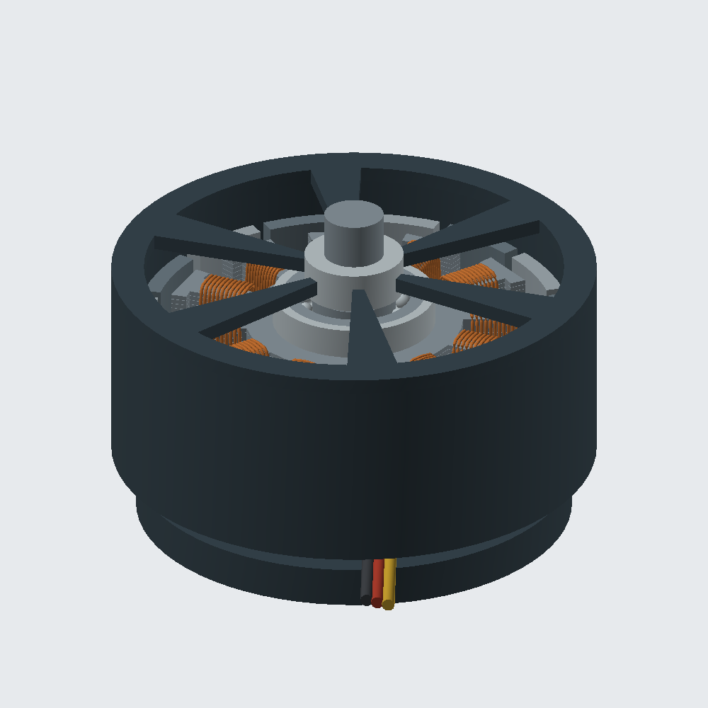

# CYBR GEO

A small Python geometry core: author surfaces, fields and relationships, then inspect and edit the resulting geometry. No built-in motor, tree or humanoid factories.

This rewrite is an experimental mesh-based core, not API-compatible with the previous CAD/`lab` implementation. It does not replace all of that implementation's functionality.

## See what the code makes

[](media/motor_inspection.mp4)

**Brushless motor:** [step-by-step construction film](media/motor-construction.mp4) · [complete authoring source](examples/motor.py) · [inspection film](media/motor_inspection.mp4) · [scope and limitations](docs/MOTOR_SCOPE.txt). Authored meshes, not a prefab or a validated electrical motor.

[](media/vessel.mp4)

**Vessel:** [source](examples/vessel.py) · [animated construction](media/vessel.mp4). Runtime values and geometry explain the program; this is not a manufacturing simulation.


**More geometry:** [terrain](examples/terrain.py), [woven surfaces](examples/weave.py), [profile/fin](examples/fin.py), [mechanism](examples/crank.py). These are geometry inspection views, not photorealistic output or engineering certification.

[](media/motor-construction.mp4)

## Install and run

Python 3.11+. Core dependency: NumPy. Polygon extrusion examples also use SciPy.

```sh
python -m pip install -e '.[profiles]'
python -m unittest discover -s tests -v
python examples/motor.py
```

The motor script builds the assembly in memory. It does not render a video by itself.

## A real, small example

```python
import numpy as np
import cybrgeo as geo

# One continuous sampled surface, not separately placed planes.
x = np.linspace(-2, 2, 65)
y = np.linspace(-2, 2, 65)
xx, yy = np.meshgrid(x, y, indexing="ij")
mesh = geo.heightfield(x, y, np.exp(-(xx**2 + yy**2)))

# A named selection is a continuous vertex attribute.
mesh = geo.region(mesh, "center", lambda p: np.exp(-3 * (p[:, 0]**2 + p[:, 1]**2)))
mesh = geo.sculpt(mesh, lambda p: np.tile([0, 0, 0.2], (len(p), 1)), region="center")
geo.save_snapshot(mesh, "hill.npz")
print(geo.inspect(mesh))
```

`heightfield` makes the topology; `region` stores a selection; `sculpt` edits those vertices; `save_snapshot` preserves the mesh and its attributes.

## Core, not a catalog of objects

| Capability | Interface | Boundary |
|---|---|---|
| Signed functions to surfaces | `field`, `sparse_surface` | Sampled approximation, not exact CAD |
| Explicit surface construction | `loft`, `heightfield`, `parametric_surface` | Author supplies samples/correspondence |
| Polygon solids with holes | `extrude` | Polygonal boundaries; rejects unresolved triangulation |
| Connected edits and attributes | `region`, `sculpt`, `subdivide` | Known operation transfer, not arbitrary remesh naming |
| Skinning and placement | `skin`, `transform`, `rotation`, `Instances` | Explicit bindings, not automatic anatomy |
| Networks | `CurveNetwork`, `NetworkField` | Simulations can supply network state; no tree preset |
| Kinematic relationships | `Kinematics` | Point closure/rigid poses, not force dynamics |
| Incremental builds | `Graph` | Reuses declared dependency nodes, not automatic spatial partitioning |
| Exchange | `export_obj`, `export_bundle` | Portable geometry; native MATERIAL/LIGHT integration unverified |

Intersections are not universally forbidden. Separate parts can intentionally overlap; cavities can be described by signed fields or polygon holes. Topological validity is different from collision clearance. A shaft through an actual bore is different from a shaft penetrating solid material.

## Construction feedback

Meshes are immutable. Topology checks report disconnected components, boundary/nonmanifold edges and vertices, degenerate triangles and winding. Open surfaces are explicit. They do **not** detect every geometric self-intersection or prove structural soundness.

The incremental graph retains the previous successful build when a candidate operation fails. Inputs and changing dependencies must be declared; hidden mutable globals are not supported. [Graph contract and measured CPU benchmarks](docs/INCREMENTAL.md).

37 focused tests passed on the current local source. This is not a full certification, GPU benchmark or proof of realistic quality.

## Source map

```text
cybrgeo/
  model.py       immutable meshes, attributes and topology reports
  field.py       signed-field extraction
  surface.py     loft, terrain patches, selection, sculpt, subdivision
  profiles.py    polygon extrusion
  network.py     networks, parametric surfaces, instancing
  sparse.py      sparse field extraction
  deform.py      transforms and skinning
  relations.py   kinematic relationships
  graph.py       explicit dependency caching and build reports
  exchange.py    portable exports
examples/        ordinary author-written Python, with all helpers visible
tests/           core behavior checks
benchmarks/      reproducible narrow CPU construction benchmarks
media/           actual geometry previews and explanatory videos
```

## Limits and continuity

Not implemented here: exact CAD Booleans, certified collision-free motion, finite-element structural analysis, electromagnetic motor simulation, production anatomy, automatic high-quality asset generation, or a renderer. Resolution can miss thin features; Loop subdivision can shrink/soften geometry; skinning can self-intersect. Geometry quality still depends on authored construction.

This rewrite intentionally does not import the old part library. Replacing its default source tree must not be confused with preserving compatibility with old consumers. Historical work belongs in retained Git history/legacy references, not hidden inside this core.

Project code retains the repository's GPL-2.0-only license. Media here are generated geometry demonstrations from accompanying authoring programs, not licensed stock assets. Third-party dependencies retain their own licenses.
