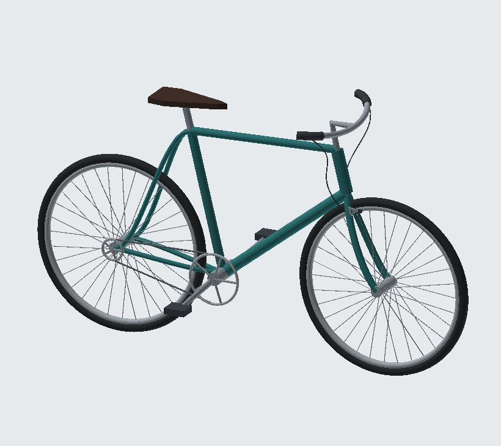
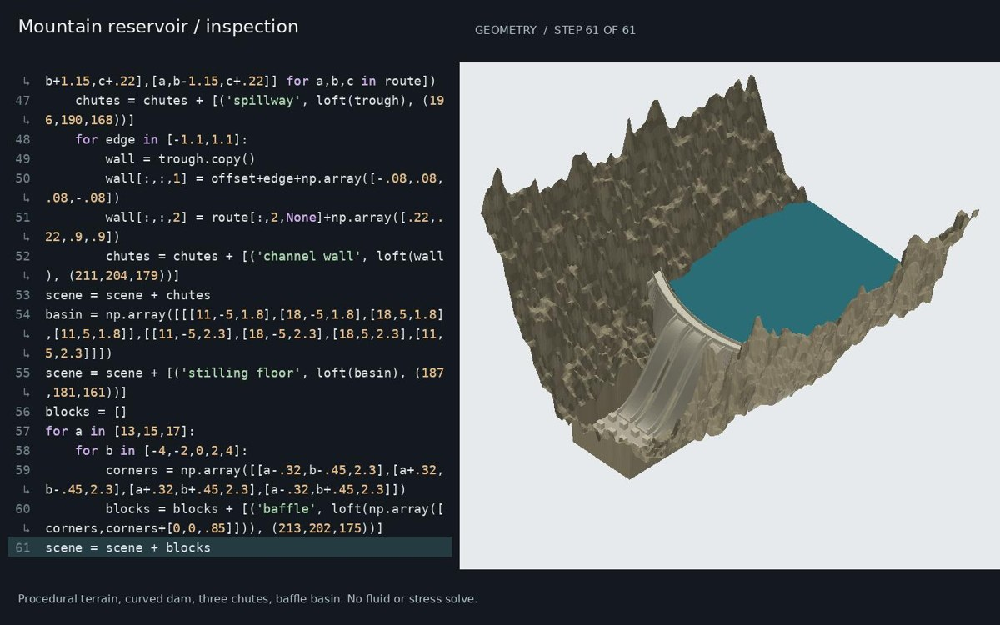
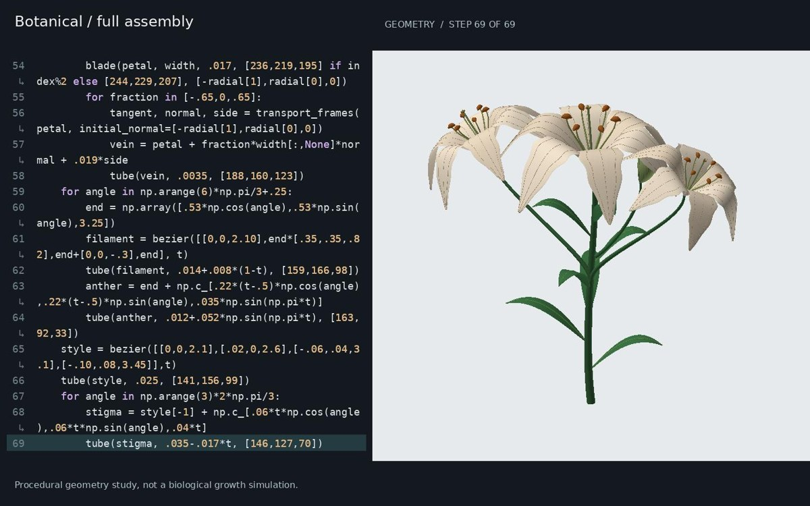
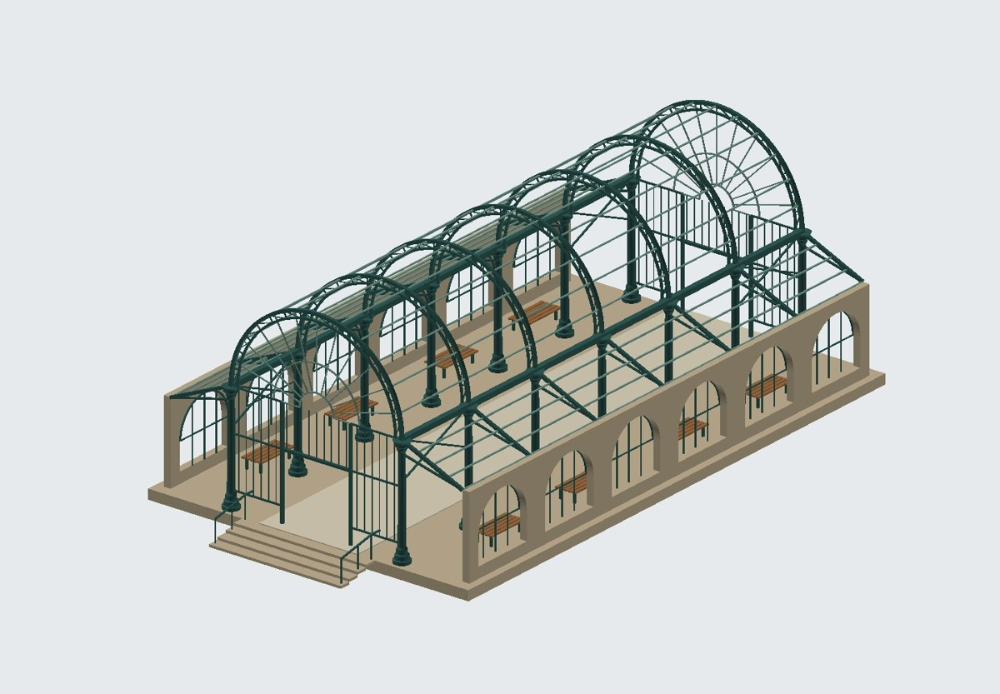
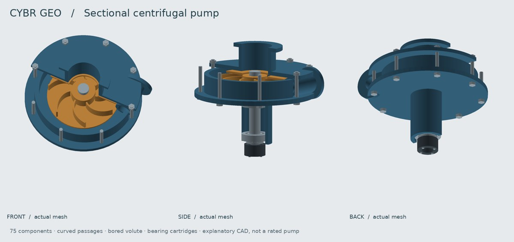
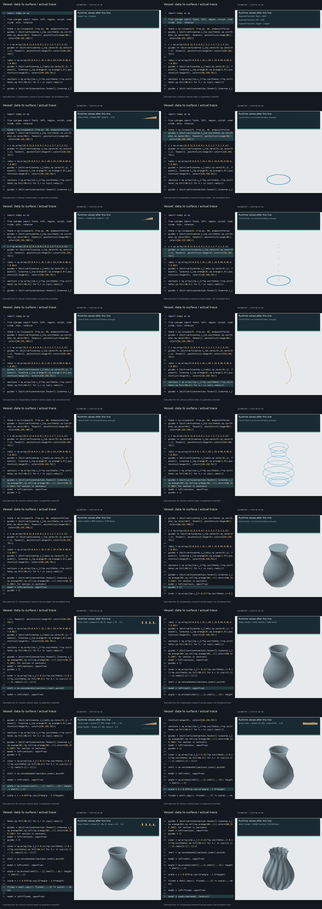
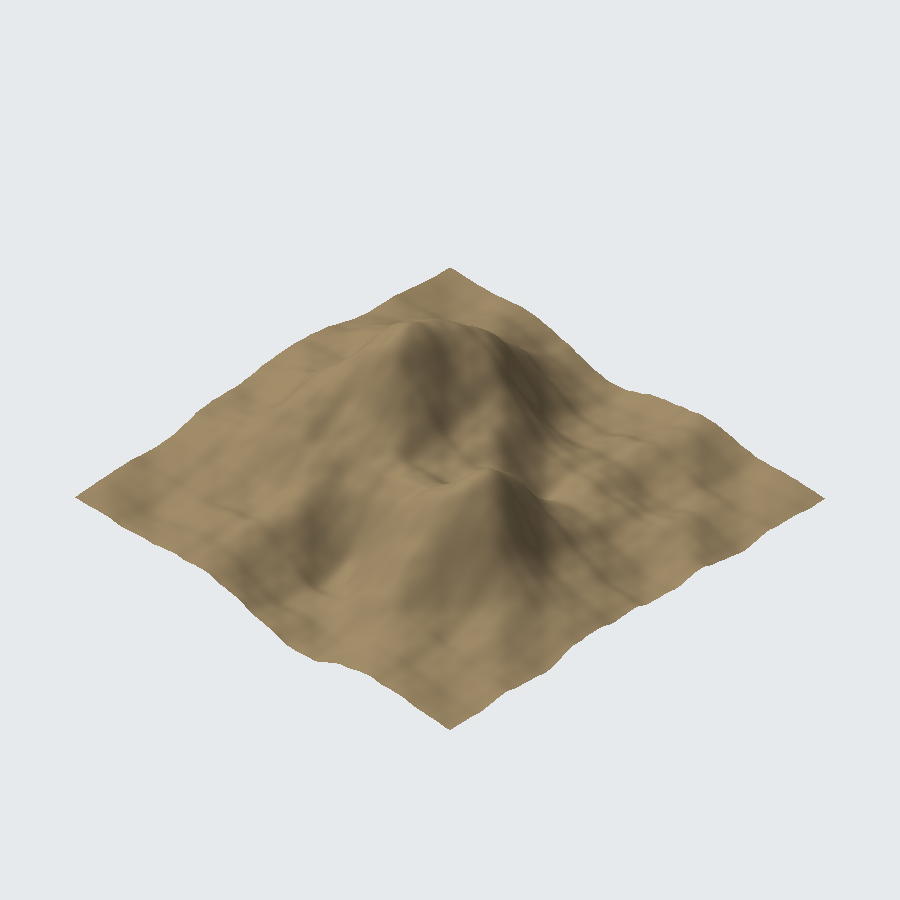
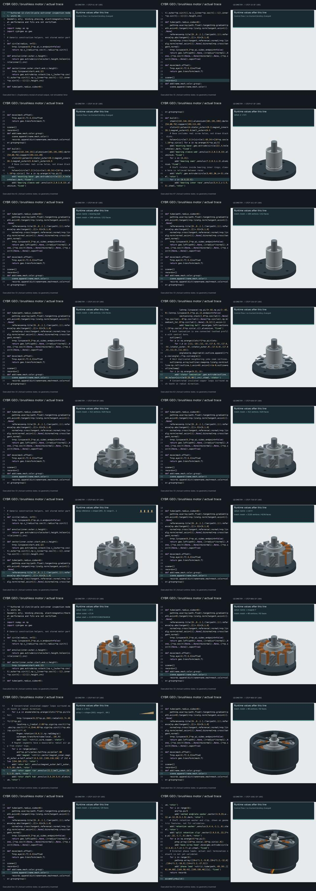

# CYBR GEO

[Construction workflow](docs/CORE_WORKFLOW.md) · [Protected assemblies](docs/PHYSICAL_ASSEMBLIES.md) · [Surface attachments](docs/surface-attachments.md)

## Surface construction and agent workflow

Start with [AGENTS.md](AGENTS.md) and [the modeling workflow](docs/AGENT_MODELING.md).
Build primary form, real construction and shared-host relationships before decorative detail.
Keep asset recipes outside the general-purpose core; use earlier good authoring programs
as regression cases rather than replacing their construction with simpler panels.

The new [surface-network API](SURFACE_API.md) adds explicit C0/C1/C2 parametric
seam constraints, constrained fitting, polygonal UV trims with holes, joined tessellation,
and preserved analytic corner normals and UVs. See [the executable example](examples/surface_contracts.py):

```sh
python -m examples.surface_contracts
```

Surface networks protect declared patch seams, not arbitrary closed-solid construction.
They do not certify global nonintersection, exact curved CAD trimming, physical function
or production-quality design. The protected assembly graph remains a separate opt-in workflow.

This update also fixes degree-zero Bézier evaluation, preserves OBJ normal attributes,
recovers authored collinear polygon cap boundaries without moving them, and removes
quadratic vertex-ID membership work during topology edits. Focused regression tests
cover these changes. Existing media below are earlier demonstrations, not new renders
or proof of these additions.

## New reproducible workflows

These are focused capability examples, not AAA assets or engineering certification.

| Example | What it demonstrates |
|---|---|
| [Protected cartridge](examples/protected_cartridge.py) | Bore-derived insert size and placement, dependent rebuild, rejection and rollback of a zero-clearance edit |
| [Periodic tube](examples/periodic_tube.py) | One continuous closed nonplanar sweep with periodic frame correction |
| [Following a surface](examples/follow_surface.py) | Explicit barycentric correspondence through refinement, no nearest-surface guessing |

```sh
python -m examples.protected_cartridge
python -m examples.periodic_tube
python -m examples.follow_surface
```

`Graph(physical=True)` makes registered finished parts mandatory, checks all of them even for partial output, rejects blanket overlap waivers and unregistered geometry, and freezes accepted output containers. Use actual Boolean unions for material joins. Transient cutters remain operations, not finished parts. `fit` derives dependent construction from host features.

Scope is deliberately narrow: closed valid solid input is still a caller assumption. This does not certify arbitrary self-intersections, sewn contacts, attachment footprints, structural strength or mechanism dynamics. Separated but detached geometry is not automatically invalid. Ordinary `Graph()` remains available for general/open-surface modeling and is not a protected physical assembly.


A small Python geometry core: author surfaces, fields and relationships, then inspect and edit the resulting geometry. No built-in motor, tree or humanoid factories.

This rewrite is an experimental mesh-based core, not API-compatible with the previous CAD/`lab` implementation. It does not replace all of that implementation's functionality.

## Earlier construction examples


Five different subjects, built with the shared operations below. Click an image for its construction video; the complete authoring code is linked alongside it. These are rasterized views of real meshes, not image-generated stand-ins.

| Example | Construction preview | Complete source |
|---|---|---|
| Bicycle: hollow frame sweeps, rims, spokes and controls | [](media/bicycle.mp4) | [bicycle.py](examples/bicycle.py) |
| Mountain reservoir: terrain, basin and authored infrastructure | [](media/reservoir.mp4) | [reservoir.py](examples/reservoir.py) |
| Botanical forms: stems, petals and explicit surfaces | [](media/botanical.mp4) | [botanical.py](examples/botanical.py) |
| Winter garden: swept frame and repeated architectural members | [](media/winter-garden.mp4) | [winter_garden.py](examples/winter_garden.py) |
| Sectional pump: casing, impeller, shaft and bearing geometry | [](media/pump.mp4) | [pump.py](examples/pump.py) |

The films explain authored construction, not dynamics. The reservoir is not a hydraulic simulation; the flowers are not a calibrated growth simulation. The winter garden omits glazing for inspection. The bicycle and pump are geometry studies, not mechanically certified products. Per-part closure is not proof of assembly-wide clearance or structural fitness.


## See what the code makes

[](media/motor_inspection.mp4)

**Brushless motor:** [step-by-step construction film](media/motor-construction.mp4) · [complete authoring source](examples/motor.py) · [inspection film](media/motor_inspection.mp4) · [scope and limitations](docs/MOTOR_SCOPE.txt). Authored meshes, not a prefab or a validated electrical motor.

[](media/vessel.mp4)

**Vessel:** [source](examples/vessel.py) · [animated construction](media/vessel.mp4). Runtime values and geometry explain the program; this is not a manufacturing simulation.



**More geometry:** [terrain](examples/terrain.py), [woven surfaces](examples/weave.py), [profile/fin](examples/fin.py), [mechanism](examples/crank.py). These are geometry inspection views, not photorealistic output or engineering certification.

[](media/motor-construction.mp4)

## Install and run

Python 3.11+. Core dependency: NumPy. Polygon extrusion examples also use SciPy.

```sh
python -m pip install -e '.[profiles,solid]'
python -m unittest discover -s tests -v
python examples/motor.py
```

The motor script builds the assembly in memory. It does not render a video by itself.

## A real, small example

```python
import numpy as np
import cybrgeo as geo

# One continuous sampled surface, not separately placed planes.
x = np.linspace(-2, 2, 65)
y = np.linspace(-2, 2, 65)
xx, yy = np.meshgrid(x, y, indexing="ij")
mesh = geo.heightfield(x, y, np.exp(-(xx**2 + yy**2)))

# A named selection is a continuous vertex attribute.
mesh = geo.region(mesh, "center", lambda p: np.exp(-3 * (p[:, 0]**2 + p[:, 1]**2)))
mesh = geo.sculpt(mesh, lambda p: np.tile([0, 0, 0.2], (len(p), 1)), region="center")
geo.save_snapshot(mesh, "hill.npz")
print(geo.inspect(mesh))
```

`heightfield` makes the topology; `region` stores a selection; `sculpt` edits those vertices; `save_snapshot` preserves the mesh and its attributes.

## Core, not a catalog of objects

| Capability | Interface | Boundary |
|---|---|---|
| Signed functions to surfaces | `field`, `sparse_surface` | Sampled approximation, not exact CAD |
| Explicit surface construction | `loft`, `heightfield`, `parametric_surface` | Author supplies samples/correspondence |
| Polygon solids with holes | `extrude` | Polygonal boundaries; rejects unresolved triangulation |
| Connected edits and attributes | `region`, `sculpt`, `subdivide` | Known operation transfer, not arbitrary remesh naming |
| Skinning and placement | `skin`, `transform`, `rotation`, `Instances` | Explicit bindings, not automatic anatomy |
| Networks | `CurveNetwork`, `NetworkField` | Simulations can supply network state; no tree preset |
| Kinematic relationships | `Kinematics` | Point closure/rigid poses, not force dynamics |
| Incremental builds | `Graph` | Reuses declared dependency nodes, not automatic spatial partitioning |
| Exchange | `export_obj`, `export_bundle` | Portable geometry; native MATERIAL/LIGHT integration unverified |

Intersections are not universally forbidden. Separate parts can intentionally overlap; cavities can be described by signed fields or polygon holes. Topological validity is different from collision clearance. A shaft through an actual bore is different from a shaft penetrating solid material.

## Construction feedback

Meshes are immutable. Topology checks report disconnected components, boundary/nonmanifold edges and vertices, degenerate triangles and winding. Open surfaces are explicit. They do **not** detect every geometric self-intersection or prove structural soundness.

The incremental graph retains the previous successful build when a candidate operation fails. Inputs and changing dependencies must be declared; hidden mutable globals are not supported. [Graph contract and measured CPU benchmarks](docs/INCREMENTAL.md).

235 tests passed on the release source, including three executable workflow examples. This is not a full certification, GPU benchmark or proof of realistic quality.

## Source map

```text
cybrgeo/
  model.py       immutable meshes, attributes and topology reports
  field.py       signed-field extraction
  surface.py     loft, terrain patches, selection, sculpt, subdivision
  profiles.py    polygon extrusion
  network.py     networks, parametric surfaces, instancing
  sparse.py      sparse field extraction
  deform.py      transforms and skinning
  relations.py   kinematic relationships
  graph.py       explicit dependency caching and build reports
  surface_network.py  constrained patch networks, UV trims and joined tessellation
  solid.py       optional OpenCascade-backed analytic solids
  exchange.py    portable exports
examples/        ordinary author-written Python, with all helpers visible
tests/           core behavior checks
benchmarks/      reproducible narrow CPU construction benchmarks
media/           actual geometry previews and explanatory videos
```

## Limits and continuity

The optional `solid` backend wraps OpenCascade (through CadQuery) for analytic Boolean cuts, shells, fillets and lofts; CYBR GEO does not implement that kernel itself. The default mesh operations remain distinct.

Not implemented here: certified collision-free motion, finite-element structural analysis, electromagnetic motor simulation, production anatomy, automatic high-quality asset generation, or a renderer. Resolution can miss thin features; Loop subdivision can shrink/soften geometry; skinning can self-intersect. Geometry quality still depends on authored construction.

This rewrite intentionally does not import the old part library. Replacing its default source tree must not be confused with preserving compatibility with old consumers. Historical work belongs in retained Git history/legacy references, not hidden inside this core.

Project code retains the repository's GPL-2.0-only license. Media here are generated geometry demonstrations from accompanying authoring programs, not licensed stock assets. Third-party dependencies retain their own licenses.

