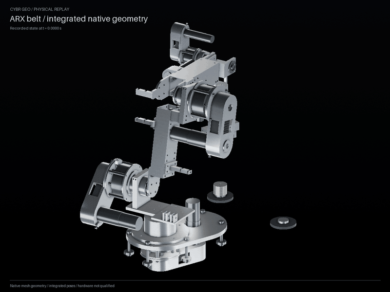

# CYBR GEO

**Procedural CAD, mechanical assemblies and geometry-driven rendering.**

One parametric recipe produces named parts, analytic solids, inspection views, motion, drawings and renderable geometry. Built in Python with CadQuery/OpenCascade, with an in-house C++ photographic path tracer and a separate Mitsuba/OIDN rendering backend.

**One reusable engineering architecture, with ARX and IRIS as examples.** Native
construction, physical materials, CAD mass/inertia, mating geometry, contacts,
electrical drives, springs, brakes and MuJoCo feed the existing assembly and
rendering API. The default ARX belt example directly reuses its published source
and transfers an independent puck through simulated contact. Examples supply
designs and tasks; construction, control and replay services are shared.
[Architecture and evidence](docs/CONSTRUCTIVE_MECHANISMS.md) ·
[Author a mechanism](docs/MECHANISM_SOURCE.md).



*Fresh native CAD posed by integrated body states. Puck motion comes from contact,
not an attachment or animation path. [Evidence and limits](docs/pr-assets/arx-engineering/README.md).
IRIS remains a source-derived geometric study; hardware is unqualified.*


*ORBIT: 148 components, geared wrist, opposed-screw gripper, hollow palm and removable housing.* [Recipe](examples/orbit_inspection_wrist.py) · [Service sequence](docs/ORBIT_SERVICE.md) · [Geometry coverage](docs/ORBIT_SHOWCASE.md)

## Selected work

| Project | Engineering focus | Source |
| --- | --- | --- |
| **ORBIT** | Analytic assemblies, gearing, motion and a 331-operation service sequence | [Wrist recipe](examples/orbit_inspection_wrist.py) |
| **ROAM** | Seven workshop mechanisms and an articulated mobile workstation | [Workshop](examples/roam/README.md) |
| **Nitinol actuator** | Twelve SMA fibers, guided carriage and explicit electrical routing | [Actuator recipe](src/mechanism_lab/models/nitinol_actuator.py) |
| **Motor / belt drive** | Procedural motor construction, pulley/belt geometry and mechanical integration | [Motor](src/mechanism_lab/models/motor.py) · [Drivetrain](src/mechanism_lab/models/drivetrain.py) |
| **Differential** | Internal inspection, exploded views and prescribed differential kinematics | [Study](examples/differential/README.md) |
| **CYBR YARD** | A 1,404-part parametric skatepark, timber framing and outdoor rendering | [Recipe](examples/diy_skatepark/recipe.py) |


## Run it

Use the [Windows, Linux and macOS setup guide](docs/PLATFORMS.md) for platform
prerequisites and supported backends. Linux CI covers Python **3.11-3.13**;
the Windows x64 and Apple Silicon matrix uses **3.12**. On Ubuntu:

```bash
sudo apt-get update
sudo apt-get install -y g++ cmake ffmpeg libcairo2 libegl1 libgl1 libopengl0 libglib2.0-0
git clone https://github.com/cybrdelic/cybr-geo.git
cd cybr-geo
python3 -m venv .venv
source .venv/bin/activate
python -m pip install -r requirements-tested.txt
python -m pip install --no-deps --no-build-isolation -e .
lab mechanism --step --media
```

`lab mechanism` builds the actual ARX belt example through shared services and
runs its ten-second causal contact task. **`outputs/arx_belt/`** contains native
and placed STEP, GLB, material/mass records, editable physical source, motor
results, simulation traces and actual rendered PNG/GIF views. Allow several
minutes for initial construction. Ratings and material properties remain
explicit assumptions; complete ARX motion-envelope and hardware qualification
are not established by this run.

This first run needs no reference archive, downloaded HDRI or denoiser. Rendering
needs a supported graphics context. `lab preview --step` chooses the native
path tracer when its toolchain works, or the actual VTK geometry renderer when
that toolchain is unavailable. It defaults to `arx_belt` and writes
`outputs/arx_belt/preview/`; its receipt records the selected backend.
Use `lab preview example_flange` for the previous quick static example.

```bash
lab mechanism arx_belt --step --media
lab animate arx_belt --seconds 10
lab mechanism examples/constructed/compact_arm.json --step --media
lab preview nitinol_fiber_actuator --spp 64
lab preview examples/custom_flange.py --step
lab build nitinol_fiber_actuator --step --stl
lab animate nitinol_fiber_actuator --seconds 6
lab blueprint nitinol_fiber_actuator
```

For the full photographic workflow, `lab render`, `lab video` and `lab film` use V9 by default. That backend uses Mitsuba, OIDN and downloaded CC0 studio assets; see [rendering setup](docs/SHARED_PHOTOGRAPHY.md). Select `--renderer photoreal` for the in-house native tracer or `--renderer pbr` for the raster preview. [More commands and reference preparation](docs/GETTING_STARTED.md).

## How it works

| System | Implementation |
| --- | --- |
| Geometry contract | [`Assembly`, `Part`, `Material`, `View`](src/mechanism_lab/core.py); named components and rigid poses |
| Engineering source | [Project protocol](src/mechanism_lab/engineering_source.py), [native construction](src/mechanism_lab/native_construction.py), [CSG DAG](src/mechanism_lab/shape_dag.py), [physical tree](src/mechanism_lab/physical_model.py) |
| Causal engineering execution | [Shared pipeline](src/mechanism_lab/engineering_pipeline.py), [electromechanical kernels](src/mechanism_lab/actuation.py), [MuJoCo runtime](src/mechanism_lab/causal_runtime.py), [recorded replay](src/mechanism_lab/physical_replay.py) |
| Component document compatibility | [Component compiler](src/mechanism_lab/construction.py), [continuous path clearance](src/mechanism_lab/motion_envelope.py), [Studio](studio/README.md) |
| Parametric construction | [CAD helpers](src/mechanism_lab/geometry.py), [advanced geometry](src/mechanism_lab/advanced_geometry.py), [recipes](src/mechanism_lab/models) |
| Reusable pipeline | [Recipe registry and cache](src/mechanism_lab/registry.py), [one-command preview](src/mechanism_lab/preview.py) |
| Native photography | [Thin-lens BVH/GGX/MIS tracer](src/mechanism_lab/native/photoreal.cpp), [Python adapter](src/mechanism_lab/photoreal.py) |
| CAD and interchange | [STEP, STL, GLB and animated glTF](src/mechanism_lab/exporters.py); explicit mm/Z-up → m/Y-up conversion |
| Drawings | [OpenCascade hidden-line projection and vector drawing export](src/mechanism_lab/whiteprint.py) |
| Assembly motion | [Service process and clearance checks](src/mechanism_lab/assembly_process.py) |

Recipes define the object; shared code handles its outputs. Geometry validation runs during recipe creation and its report is retained with the cache. Source, declared recipe dependencies and retained input changes invalidate that cache. The original `cybrgeo` CLI/API remains available alongside `lab`.

## Development

```bash
make test-core       # independent geometry / rendering contracts
make test-mechanisms # shared construction, kinematics, cache and Studio routes
make preview         # real CAD → GLB / STEP → native image
make test            # complete suite; see prerequisite notes below
```

[Quickstart CI](.github/workflows/quickstart.yml) exercises the documented install and preview on Python 3.11–3.13. The [complete regression workflow](.github/workflows/recovery-regressions.yml) regenerates the differential inputs before running the full suite. Historical release-output tests can skip when their archives are absent; [test scope and setup](docs/GETTING_STARTED.md#tests) explains the distinction.

## Scope and license

The shared core supports native CAD, rendering, kinematic studies and explicitly scoped MuJoCo dynamics. Physical load capacity, fatigue, production fits and hardware qualification remain separate work. Vendor CAD is identified where used; conceptual internals and original geometry retain their provenance. [Sources](docs/MOTOR_SOURCES.md) · [Compatibility](docs/COMPATIBILITY.md) · [Publication inventory](docs/PUBLICATION_INVENTORY.md) · [Architecture](docs/ARCHITECTURE.md).

GPL-2.0-only for project code. Third-party assets retain their own rights. Created by [Alejandro Figueroa / cybrdelic](https://github.com/cybrdelic).
