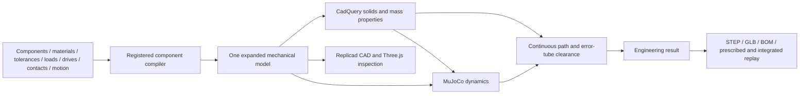
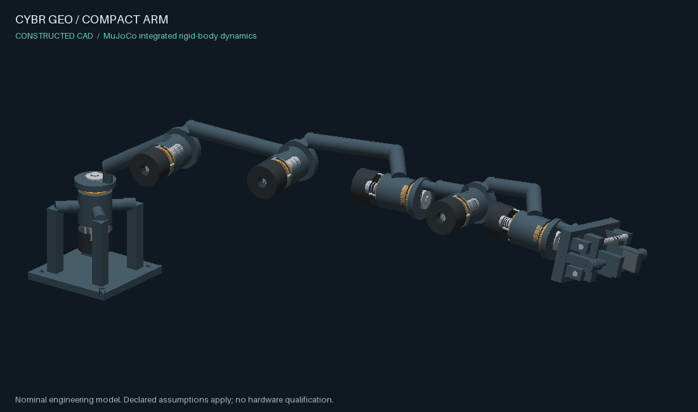

# Bounded component studies (retained compatibility evidence)

This records the earlier component-document implementation and its evidence.
Its reference-ingestion status is historical. The current native default and
actual source reuse are described in [Shared engineering construction](CONSTRUCTIVE_MECHANISMS.md).
These results do not transfer to ARX or IRIS.

CYBR GEO uses one canonical document and one component compiler. The included
arm and head documents exercise that compiler; they are not separate mechanical
implementations, nor reproductions of IRIS-09 or ARX-6. Existing Python recipes
and the original `cybrgeo` API remain available.



## Authoring and construction

[The source contract](MECHANISM_SOURCE.md) describes editable JSON documents and
trusted Python component extensions. The registered component expands both sides
of an interface from the same datum and dimensions. Its parts, joints, drive
relations, materials, support paths and fit requirements are lowered together.
CAD backends contain no architecture-name branches.

The current built-in catalog is deliberately bounded: rotary cartridges and
parallel grippers in supported serial frames. A new component registers its
validator and expander; it does not add another arm generator. Nonlinear
pin-slot closure, arbitrary loop constraints and an iris mechanism are not yet
implemented. Unsupported requests are rejected before CAD construction.

Physical material records are separate from render finishes. Nominal clearance
and shaft/bore tolerance bounds are combined before geometry. The compiler
rejects insufficient fit clearance and insufficient declared actuator effort
using conservative positive-CSG mass and reference-layout load estimates.
These are construction constraints. They do not establish production fits,
local keyway stress, bearing life, structural deflection, fatigue or thermal duty.

The source digest binds the authored mechanical assumptions. The geometry digest
binds parts and joints. The full model digest also binds component definitions
and derived physical metadata. Changed loads, materials, actuator limits or
contact assumptions invalidate the engineering result even when triangles are
unchanged.

## Run the shared pipeline

```bash
lab mechanism examples/constructed/compact_arm.json --step --media
lab build examples/constructed/compact_arm.json --step
lab animate examples/constructed/compact_arm.json --seconds 8
```

`lab mechanism` writes an engineering bundle under `outputs/mechanisms/`.
`mechanism.json` is the canonical input; `recipe.json` is its expanded model.
The bundle contains actual analytic STEP, static and animated GLB, BOM,
`engineering.json`, `motion-envelope.json`, MJCF, explicit simulation meshes,
MuJoCo traces and tracking plots. `--media` renders actual CAD triangles.
`motion.gif` shows the requested kinematics; `simulation/motion.gif` shows the
integrated MuJoCo response. Neither is image-generated evidence.

`lab build` and `lab animate` run the same engineering pipeline for canonical
mechanism inputs and compatibility aliases. Failed analysis prevents publishing
accepted motion. `lab animate` exports the integrated response. Static preview
and low-level articulation remain inspection tools; displaying a pose does not
authorize it. Legacy nonmechanical recipes retain their existing behavior.

```bash
python tools/verify_construction_bundle.py outputs/mechanisms/compact_arm \
  --samples 17 --out outputs/mechanisms/compact_arm/artifact-readback.json
make test-mechanisms
```

The artifact verifier reopens STEP and GLB, checks source and file hashes, and
decodes actual animation node transforms. Inspect its result and the media,
not merely the presence of `bundle.json`. Engineering runs retain failures.

## Physics and motion scope

MuJoCo receives the same joint graph, exact CAD volume/center of mass/inertia,
physical density, payload, gravity, actuator bounds and explicit collision
primitives. The backend integrates rigid-body dynamics with effort-limited
computed-torque control. Transmission equalities are finite numerical
constraints: residuals and solver settings are recorded, not assumed zero.
Actual speed, acceleration, applied effort and saturation are reported.

Visual meshes are not silently used as filled convex collision hulls. Current
component proxies are material-contained primitives; cut parts are omitted and
listed. Their contacts are disabled in the included studies by explicit source
policy. Source-declared ground and free bodies can exercise actual contact.
Consequently, a successful arm trajectory does not prove object manipulation,
full self-contact, belt traction or successful gripping.

The clearance certifier uses actual CAD distances plus conservative rigid-body
interval displacement bounds. It covers the continuous specified path and the
explicit joint/follower error tube, and fails closed when it cannot resolve a
pair. It checks source-to-B-rep identity. Every retained numerical integration
state must lie in the certified tube before that run is accepted. This is not
full joint-space clearance, a proof between physics integration steps, or a
hardware safety certificate. Imported JSON flags never grant runtime authority.

## Recorded evidence

The [current receipt](pr-assets/engineering/evidence.json) binds the following
results to canonical source `d655f957...` and model `9c3a583e...`:

| Executed result | Evidence |
| --- | --- |
| 109 valid STEP solids and 109 GLB meshes; 245 artifact hashes checked | [Independent readback](pr-assets/engineering/artifact-readback.json) |
| All 5,886 part pairs over the continuous specified path and error tube; 6,270 interval visits | [Clearance summary](pr-assets/engineering/evidence.json) |
| MuJoCo 3.16, 8 seconds, 2 ms steps; 4,001 states inside the tube | [Simulation and membership summary](pr-assets/engineering/evidence.json) |
| Worst rotary tracking error 0.001408 degrees; jaw error 0.001131 mm; declared operating limits passed | [Tracking plot](pr-assets/engineering/tracking.svg) |
| Requested and integrated GLB replay decoded at 17 times; maximum sampled vertex discrepancy below 0.000009 mm | [Readback](pr-assets/engineering/artifact-readback.json) |
| Actual native/WASM CAD and motion parity, including a new four-axis composition authored as data | [Browser CAD receipt](../studio/web-auth/evidence/acceptance.json) |
| 109 parts at five actual MuJoCo poses matched Three.js vertices within 4.6e-13 mm | [Replay receipt](../studio/web-auth/evidence/simulation-replay.json) |
| Accepted current engineering result; rejected stale, imported and failed results | [Browser gate receipt](../studio/web-auth/evidence/engineering-gate.json) |



[Integrated GIF](pr-assets/engineering/simulated-motion.gif) and
[prescribed GIF](pr-assets/engineering/prescribed-motion.gif) are software mesh
renders from the actual model. No image generation was used. They are not live
browser screenshots. This executor exposed no browser surface for live UI QA.

The mechanical regression target passed **151 tests plus 13 subtests**; browser
tests passed **18/18**. Existing core checks passed **37 tests** locally; the
native photographic preview test could not run because Windows has no `g++`
with OpenMP. Quickstart CI for the prior published commit passed that real
preview on Linux with Python 3.11, 3.12 and 3.13. Those CI results do not replace
checks of this revision.

The [original belt-component diagnostic](pr-assets/engineering/belt-diagnostic.json)
is deliberately retained as a failure. Tracking passes, but motor startup
acceleration reaches 2,836 and 1,637 degrees/s² against declared 40 degrees/s²
limits. Refining numerical transmission constraints did not make this an
accepted operating case. It needs a physically specified drive/initialization
model. This is not the ARX belt design and does not transfer a claim to it.

## Reference designs and provenance

IRIS-09, ARX-6 belt and ARX-6 compact are distinct reference designs. Their
validation claims must remain separate.

The public [IRIS source](https://github.com/cybrdelic/cybr-iris09/tree/6aac71594c211cc5934674b2113d9db8c5ec17c6)
was inspected at the pinned commit. `bodyMap` creates a detailed analytic SDF
housing with mounting ears, holes, slots and captive screw shapes. `hitIris`
uses nine hinges, circular-prism intersections, canted leaf sheets and a fixed
world clipping cylinder. Its handle and leaf motion are prescribed functions
of time. There is no recovered transmission, constraint closure, load model or
dynamics solver. The clipping boundary can change the displayed leaf shape
with pose; a physical rigid part must instead keep its material invariant.
Its sampled-clearance comment is not a reproduced engineering result.

The recovered ARX belt architecture is being inspected separately. The parent
handoff identifies CadQuery mass/inertia, hole-preserving material collision
proxies, generated MJCF, six torque-controlled joints, opposed rack jaws and a
contact-driven puck. Electrical drive and safety logic are distinct reusable
layers. Direct reuse is only claimed after local source inspection and rights
verification. The compact cinematic reconstruction must not inherit the belt
controller or original compact scenario-suite claims.

Current evidence establishes the shared foundation and bounded components.
It does not establish parity with either ARX package or a working IRIS example.
No reference artwork or unlicensed source has been imported into this change.
