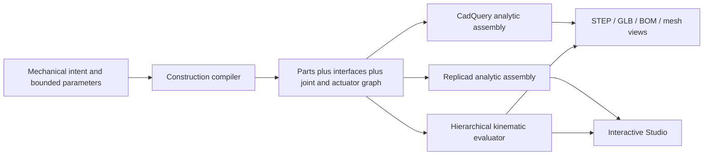
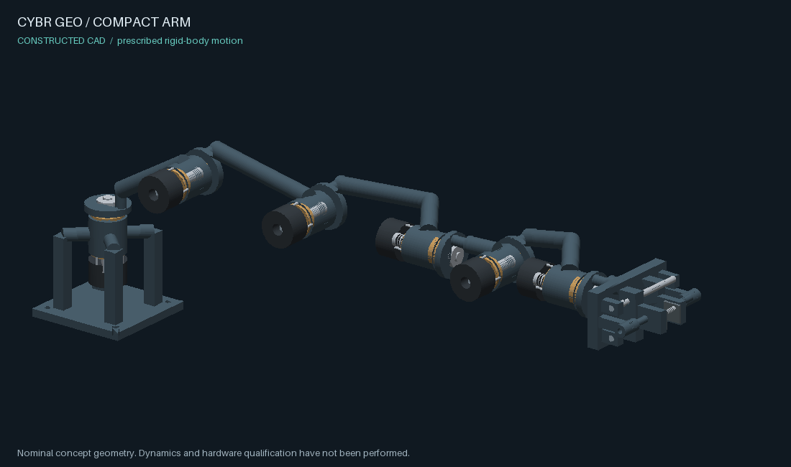

# Construction before geometry

CYBR GEO's default mechanical path starts with a bounded architecture and shared
dimensions. It constructs mating bodies, a joint tree, actuator relationships,
clearance records and support paths together. Geometry and motion consume that
same plan. The older independent Python recipes and static CAD planner remain
available.



## Run the defaults

Use the normal Python installation from the main README. These recipes need no
reference archives or external artwork.

The preset inventory is:

| Original study | Generated parts | Independent controls |
| --- | ---: | --- |
| `compact_arm` (default) | 109 | 6 rotary axes and 2 jaws |
| `belt_arm` | 121 | 6 rotary axes and 2 jaws; belt follower values are derived |
| `inspection_head` | 58 | 3 rotary axes and 2 jaws |

The jaw controls are independent. No mechanical jaw synchronization is claimed.
These counts describe the construction, not a completed qualification result.

```bash
lab build --step
lab mechanism --step --media
lab mechanism belt_arm --step --media
lab mechanism inspection_head --step --media
lab preview                         # compact_arm with the native photo renderer
lab preview example_flange          # the former default remains available
lab animate compact_arm --seconds 8
```

`lab mechanism` writes `outputs/mechanisms/<architecture>/`. The bundle includes
`recipe.json` (expanded parts and joints), `mechanism.json` (editable high-level
input), `construction.json`, `assembly.glb`, `motion.glb`, BOM and motion samples.
`--step` adds analytic STEP; `--media` adds actual tessellation PNGs and a GIF.
The mesh views use a fixed camera through the prescribed motion and do not need
a display server, renderer download, FFmpeg or image-generation service.
`bundle.json` is written only when artifact creation and GLB readback complete.

An input descriptor can be loaded through the normal registry and cache:

```json
{
  "schema": "cybrgeo-mechanism/1",
  "architecture": "compact_arm",
  "parameters": {"scale": 1.2}
}
```

Save as `arm.json`, then run `lab build arm.json --step` or
`lab animate arm.json`. For a bundle, put just the parameter object in a file
and run `lab mechanism compact_arm --parameters parameters.json --media`.
Unsupported fields and out-of-range dimensions fail before CAD creation.
The default jaw travel is `min(14, 10 * scale)` millimetres; an explicit
`jaw_travel_mm` must also be no greater than `14 * scale` to retain guide
engagement. Accepted parameter ranges are construction bounds, not tested
operating envelopes.

The lightweight [Studio](../studio/README.md) uses the same Python compiler,
then builds the plan with the real OpenCascade WebAssembly kernel. It offers
independent joint controls and an animation view. The static primitive planner
is kept separately for nonmechanical objects; it is not used to improvise a
supported mechanical assembly's pivots or interfaces.

## What is encoded

- Shared shaft and bore dimensions determine radial clearance. Paired bearing
  supports, retaining features, rigid links and actuator attachments are created
  from the same axis frames.
- Every moving body has a parent, an axis, a pivot and bounded travel. Fixed
  attachments inherit the parent's transformation; actuated joints have named
  controls. Belt followers derive their value from their source joint.
- Guides and linear actuator envelopes are constructed with the gripper. A
  cylinder is not presented as a modeled helical screw or a torque-qualified motor.
- Interfaces and load paths name the actual generated parts. These describe the
  intended nominal geometry and support topology; they are not force analysis.
- The complete plan survives the mesh cache. Reloading binds the evaluator to
  serialized joints instead of dropping motion or guessing pivots from meshes.

Retention is part of the constructed geometry. Each rotary cartridge has two
separated flanged bushings, a shaft shoulder and a removable rear split collar
with clamp-fastener envelopes. The shaft can be inserted from the output side
before the collar halves are installed radially. A keyed output flange seats
against the shaft shoulder; a boss-seated cap and an axial screw capture the
flange from the other side. The next structural carrier, or the tool palm at the
last axis, uses that flange. Belt-drive pulleys have removable keys and their own
shoulders, caps or retaining cups. Named interface records preserve nominal
clearances and assembly order along with the part identities.

The construction record also names axial capture probes. For each listed pose,
the audit virtually displaces the captured output flange or pulley along its
local shaft axis and checks that it intersects the named stop. This tests the
existence of a geometric obstruction to axial escape. It does not simulate
contact, establish clamp force or thread strength, or verify the complete
assembly/disassembly sequence. Fastener threads are simplified and actuator
internals remain purchased-component envelopes.

## Evidence and its limits

Recorded default artifacts are available as actual mesh views below. Each GIF
contains 64 frames from the generated CAD at prescribed joint poses, with a
fixed camera. These are software inspection renders, not live browser captures
or dynamics recordings.

| Original study | Reference view | Motion | Native STEP solids / GLB parts | Sampled axial captures |
| --- | --- | --- | ---: | ---: |
| Compact arm | [PNG](pr-assets/constructive/compact_arm-reference.png) | [GIF](pr-assets/constructive/compact_arm-motion.gif) | 109 / 109 | 60 / 60 |
| Belt arm | [PNG](pr-assets/constructive/belt_arm-reference.png) | [GIF](pr-assets/constructive/belt_arm-motion.gif) | 121 / 121 | 100 / 100 |
| Inspection head | [PNG](pr-assets/constructive/inspection_head-reference.png) | [GIF](pr-assets/constructive/inspection_head-motion.gif) | 58 / 58 | 30 / 30 |



The [native evidence receipt](pr-assets/constructive/evidence.json) binds these
images and artifact checks to separate construction digests. Actual CAD
intersection queries found zero unexpected intersections and zero query errors
at 0, 1, 2, 3 and 4 seconds for each default. The delivered animated GLBs were
decoded at 17 keyframes across eight seconds; the largest sampled vertex error
against the joint evaluator was below 0.000009 mm. The no-argument build and
subsequent cached animation were also executed, with unchanged cache hashes and
timestamps.

The [browser-kernel receipt](../studio/web-auth/evidence/acceptance.json) records
independent WebAssembly construction, STEP/STL readback and nine Three.js/native
motion comparisons per design. Live browser interaction was not verified because
the execution environment exposed no browser surface. The native photographic
preview was not run locally because no C++ compiler was available; the software
mesh views above were generated and inspected. Quickstart CI retains that native
preview check.

Verification included 68 construction/Studio Python tests, 11 browser tests,
11 existing core/animated-export tests and 7 existing kinematics tests. Two
historical release-artifact checks skipped because their archives were absent.

There are three separate levels of evidence:

| Level | This implementation |
| --- | --- |
| Constructed geometry and prescribed kinematics | Shared interfaces, bounded graph, rigid transforms, generated CAD/mesh and actual exported animation |
| Simulated dynamics | Not implemented: no contact/traction solver, actuator torque, inertia, friction or controller model |
| Hardware qualification | Not performed: nominal clearances are specified, but manufacturing fits/tolerance stacks, fastener preload, load/thermal/fatigue sizing and physical tests are unqualified |

`tools/audit_constructed.py` checks actual CAD intersections at explicitly
reported poses, with bounding-box pruning and exact solid intersection. It does
not silently exempt parent/child bodies. A finite pose sample is not a continuous
swept-volume proof; reports state the tested scope and any unresolved overlaps.
It also reports minimum surface distances for named interface pairs and the
axial capture probes. A distance measurement is not proof of a suitable bearing
fit or mating contact under load.

`tools/verify_construction_bundle.py` separately checks the bundle's recorded file
hashes and current compiler identity, reopens the delivered analytic STEP and
static GLB, and decodes the animated GLB's actual node transforms. It compares
those transforms with the joint graph at listed keyframes, including unit and
axis conversion. A successful bundle receipt alone is not an interference audit;
these two reports must be inspected independently.

The following commands reproduce default artifact generation and both checks
from the repository root after installation. They are instructions, not a claim
that a particular run has passed. In Bash, stop at the first failed command:

```bash
for architecture in compact_arm belt_arm inspection_head; do
  bundle="outputs/mechanisms/$architecture"
  lab mechanism "$architecture" --step --media --seconds 8 --fps 8 --size 1100x650 || exit 1
  python tools/audit_constructed.py "$architecture" \
    --times 0 1 2 3 4 --out "$bundle/cad-audit.json" || exit 1
  python tools/verify_construction_bundle.py "$bundle" \
    --samples 17 --out "$bundle/artifact-readback.json" || exit 1
done
```

For example, the individual PowerShell-compatible commands are:

```powershell
lab mechanism compact_arm --step --media --seconds 8
python tools/audit_constructed.py compact_arm --times 0 1 2 3 4 5 6 7 8 --out outputs/mechanisms/compact_arm/cad-audit.json
python tools/verify_construction_bundle.py outputs/mechanisms/compact_arm --samples 17 --out outputs/mechanisms/compact_arm/artifact-readback.json
```

Require a zero exit status and `passed: true` in each report. Inspect the actual
`reference.png`, `motion.png`, `motion.gif` and `motion.glb` as well. The GIF is a
mesh view of the prescribed joint motion, not a dynamics recording. The audit
rebuilds CAD from the architecture and parameters; its `compiled_geometry_sha256`
must match the bundle's `construction_recipe_sha256`. Its separate
`construction_recipe_sha256` hashes the full expanded audit input and is not the
same digest field. Keep reports with their matching artifacts, and rerun after
compiler or parameter changes. For a parameterized bundle, pass the same
`--parameters parameters.json` to both `lab mechanism` and the CAD audit; the
readback tool uses the saved descriptor inside the bundle.

The browser CAD kernel has a separate reproducible readback probe. After
`npm ci` in `studio/web-auth`, run the following there for a generated recipe:

```bash
npm run probe -- ../../outputs/mechanisms/compact_arm/recipe.json ../../outputs/mechanisms/compact_arm/browser
```

This builds actual WebAssembly CAD, reopens its exported STEP, checks binary STL
records and writes `browser-acceptance.json`. It does not perform the native
interference audit or prove browser interaction. Repeat with each architecture's
own recipe and destination to keep their results distinct.

**The default demonstration and manual controls have different scopes.** A
passing default audit applies only to its saved parameter values and listed
poses on the eight-second demonstration. That trajectory uses only part of each
joint's nominal range. The independent Studio sliders expose other combinations;
their full joint-range combinations have not been swept for collision freedom.
There is no runtime collision avoidance or contact solver. A parameter variation
accepted by the compiler also needs its own artifact and motion inspection.
Increasing sample density improves observation but does not establish continuous
path clearance or a safe operating workspace.

Focused regressions complement the generated-artifact checks:

```bash
python -m pytest -q tests/test_construction.py tests/test_constructed.py \
  tests/test_constructed_audit.py tests/test_construction_bundle.py \
  tests/test_mechanism_entrypoints.py studio/tests/test_planning.py
```

IRIS-09, ARX-6 compact and ARX-6 belt are **three separate benchmark designs**.
Their source packages were not readable in this implementation environment, so
no source-derived equivalence, copied geometry, comparison result or inherited
validation claim is asserted. The three built-ins are original mechanical
studies. Assessing parity with those references remains explicit follow-up work.
No reference artwork or unlicensed assets are included.

## Extending an architecture

Add paired construction operations in `mechanism_lab.construction`, rather than
inventing standalone solids then assigning arbitrary animation labels. Extend
the bounded input schema, name the interface/support relationships, construct
both sides from the same datum and dimension, and attach every moving part to
the graph. Native and browser consumers should not contain architecture-specific
geometry. Add evidence that exercises changed input dimensions and poses, then
inspect the emitted STEP/GLB and actual motion before making a claim.
