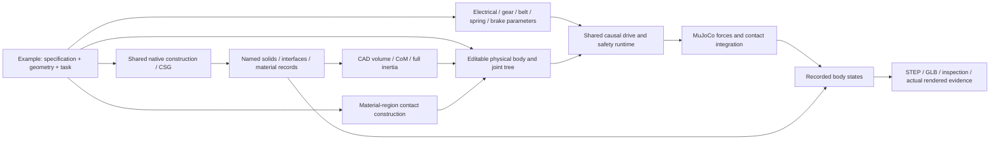

# Shared engineering construction

CYBR GEO's default is an authored engineering project executed by shared CAD,
mass, contact, actuation, MuJoCo and replay services. ARX belt is the default
example. Its actual source is adapted directly. Existing component documents
and Python recipes remain supported.



## Shared core

| Service | Contract |
| --- | --- |
| `native_construction.py` | Native parts, densities and explicit mass overrides, placements, parallel-axis inertia, exports and completion receipts |
| `shape_dag.py` | Analytic CSG with shared nodes, transforms, booleans and bounded inputs; used by component documents and imported geometry |
| `physical_model.py` | Physical tree preserving bodies, inertias, joints, transmissions, contacts and initialization; rejects unrealizable CAD inertia |
| `contact_geometry.py` | Material-region proxies, annular regions, transformed primitives and perforated tabletops |
| `actuation.py` | Source-derived voltage/current/back-EMF, gearbox/belt demand limits, thermal/energy accounting, springs, brakes and faults |
| `causal_runtime.py` | Named-joint forces applied to MuJoCo, independent free bodies, contacts, every-step extrema and state receipts |
| `physical_replay.py` | Native local geometry transformed only by recorded body states; explicit units, identity and cache restoration |
| `engineering_source.py`, `engineering_pipeline.py` | One project protocol connecting these services and retaining source/native/model/control/reference identities |

Examples supply geometry, topology, parameters and tasks. They do not own another
solver, motor implementation, mass-accounting engine or renderer. The physical
tree is serialized to `physical-source.json` and lowered to MJCF. Render meshes
cannot silently replace physical inertia or collision solids. Physical materials
are separate from display finishes.

ARX retains its authored interfaces, fasteners, bearing seats, stops and folded
transmissions. Unsupported edits to its coupled bench fixture fail before CAD.
This source-derived design does not promise that arbitrary dimension edits are
valid. New projects use the same protocol; reusable primitives belong in the
core, while design-specific construction remains in the example.

## Run it

Install the environment in the main README, then:

```bash
lab mechanism --step --media
lab mechanism arx_belt --step --media
lab preview --step
lab build arx_belt --step
lab animate arx_belt --seconds 10
```

The default builds native CAD, binds new mass/inertia and transmission records,
runs a ten-second causal contact transfer, then exports recorded motion. It needs
no benchmark checkout, archived film, network download or image generation.
Allow several minutes for the initial CAD construction and simulation.

`outputs/arx_belt/` contains `native/`, `design-source.json`,
`physical-source.json`, `model.xml`, `control-source.json`,
`simulation/trace.json.gz`, `engineering.json`, `assembly.glb` and optional STEP
and media. Native outputs retain individual/placed STEP, named mesh geometry,
component mass records, transmission data and a hashed completion receipt.
Failed tasks retain diagnostics and return failure; their GLB is named
`diagnostic-assembly.glb`.

```bash
lab mechanism arx_belt --reuse-native outputs/arx_belt/native --out outputs/arx-repeat --media
python tools/run_arx_causal.py --help
python -m examples.engineering.arx_belt.verify_geometry --help
make test-mechanisms
```

Explicit native reuse verifies the semantic specification, geometry recipe,
construction implementation and every artifact hash. Original file-byte hashes
are separate from semantic JSON identity. Cache changes invalidate motion as
well as geometry. Recorded replay holds the prior pose between samples. Generic
animated GLB interpolation is a visualization, not extra solver evidence.

Fresh project construction also writes `native-source-binding.json`, binding
the native receipt to every project Python file, `project.json` and all `data/`
inputs. Reuse requires that binding; historical builds without it must be built
again, and cannot be relabeled from current files. This is conservative: even a
controller-only edit invalidates native reuse. The binding also records an
explicit set of shared CAD, mass, core/material and contact helper hashes,
CadQuery/OpenCascade/NumPy versions and the Python/platform identity. It does
not discover arbitrary external Python imports; put authored dependencies in
the project snapshot. Native artifacts and binding are checked again before
accepted export, including after simulation and optional media rendering.

## Author another project

To author another design, create a trusted local folder with `project.json`
(`schema: cybrgeo-engineering-project/1`) and `project.py`. Its `create()` returns
an `EngineeringProject`, as in the [ARX registration](../examples/engineering/arx_belt/project.py).
Run it with `lab mechanism path/to/project --step --media`.

| Project callback | Shared boundary |
| --- | --- |
| `construct(specification, directory)` | Build named native solids, placements and material mass records through `NativeConstruction`; return a hashed completion receipt |
| `compile_physics(specification, native_directory=...)` | Return `PhysicalModel`, drive configuration and task parameters; consume the new native mass records |
| `reference(time_s, parameters)` | Supply requested joint/gap states; the shared controller computes forces |
| `requirements(result, parameters)` | State design-specific task outcomes and their scope |
| `replay(directory, result)` | Bind native local geometry to shared recorded physical-body transforms |

Keep geometry, interfaces and mechanism-specific layout in the project. Reuse
the shared CAD/CSG, inertia, contact primitives, actuation, solver and renderer;
do not fork those engines for another design. The physical tree is authoritative
for body attachment. Serialized contact records are checked against its named
geometries; historical unresolved body aliases are provenance labels, not an
independently editable attachment graph. Trusted project source and data are
snapshotted together, and changes during generation prevent accepted exports.

Geometry-only examples such as [IRIS](../examples/engineering/iris09/README.md)
and [compact ARX](../examples/engineering/arx_compact/README.md) use the same
native/CSG/render services without registering nonexistent dynamics contracts.

## Source reuse and evidence

The default directly adapts [ARX belt at aabdf8c](https://github.com/cybrdelic/cybr-arx6-belt/tree/aabdf8c57a4ee64f77b8a246ad9aca7b51d9cba2):
native generation, material-region contacts, model lowering, control and safety.
The restored source geometry cache was hash-verified before comparison.
[Source notices](../NOTICE-SOURCES.md) identify pins and retained material.

Fresh construction produced **118 unique parts and 375 placements**. **127 STEP
exports reopened as valid solids**; the source's **52 nominal BREP interface
checks** and **eight stop checks** passed. All eight body mass, CoM and full
inertia records matched the unmodified generator under the same CAD kernel.
Archived CadQuery 2.7/OpenCascade 7.8 records differ slightly from the local
2.8/7.9 spring geometry; the historical difference is retained.

The contact builder reproduces **2,095 source proxies and 315 tabletop tiles**.
Motor/fault kernels are compared numerically with actual JavaScript source.
The task reference is compared at 24,262 timestamps including boundaries.
Original XML and shared lowering produce identical retained state arrays through
the same native runtime; native/WASM differences are measured separately.

The nominal task transfers an independent puck through pad contact. No weld,
attachment, teleport or tool-following payload pose is applied. Friction loss
reproduces a drop and roughly 78 mm placement error. The original adverse-case
validator did not reject that placement, so the new task requirement does.
[Fresh receipts and actual media](pr-assets/arx-engineering/README.md) distinguish
new native builds from cached-source comparisons.

## Remaining limits

* Nominal CAD interfaces do not qualify supplier fits, production tolerance
  stacks, belt pretension, stiffness, fatigue or thermal duty. Envelope mass
  overrides remain explicit assumptions.
* ARX proxies over-cover some material regions. Small holes and flexible
  belt/spring/cable contact are omitted. This is not exact CAD contact, a complete
  continuous BREP motion envelope or full joint-space clearance.
* Arm current is request-limited before winding integration; actual transients
  can exceed those limits. The gripper additionally clamps actual current.
  Ideal power loss and finite brake friction are retained. Temperature accounting
  is not a validated thermal cutoff.
* Original failures remain unresolved: `power_loss_3.2`,
  `weak_spring_double_delay_3.2`, `weak_spring_double_delay_7.2`. Archived 21/24
  ordinary passes and four adverse controls are not a fresh full-suite pass.
* IRIS is source-derived geometry with prescribed motion. Its world clipping
  changes visible material with pose. Invariant leaves and display geometry are
  separate; no missing mechanical closure or dynamics has been invented.
* Compact ARX's CSG/render interfaces are separate. Its reconstructed PD/contact
  capture does not inherit belt's electrical, fault or validation claims.

Earlier bounded component documents remain compatible. Their continuous
prescribed-path/error-tube clearance and recorded results are documented in
[Component studies](COMPONENT_STUDIES.md); those results do not transfer to ARX
or IRIS. Studio starts the same authored engineering project as the CLI and
loads its accepted CAD export with recorded solver body transforms. Its
component editor remains an explicit compatibility route. Browser replay uses
recorded states; it does not run a separate CAD or dynamics implementation.
