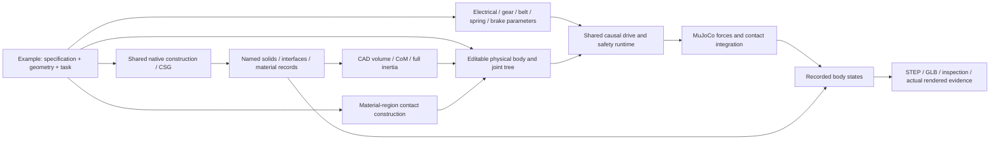

# Shared engineering construction

CYBR GEO's default is an authored engineering project executed by shared CAD,
mass, contact, actuation, MuJoCo and replay services. ARX belt is the default
example. Its actual source is adapted directly. Existing component documents
and Python recipes remain supported.



## Shared core

| Service | Contract |
| --- | --- |
| `native_construction.py` | Native parts, densities and explicit mass overrides, placements, parallel-axis inertia, exports and completion receipts |
| `shape_dag.py` | Analytic CSG with shared nodes, transforms, booleans and bounded inputs; used by component documents and imported geometry |
| `part_geometry.py` | One part resolver for CSG roots and explicit hash-bound native replacements; body-local frames, material identity and measured properties |
| `manufacturing_joints.py` | Rounded box tubes and split lap splices with coupled fit, fastener and print-envelope dimensions |
| `manufacturing_gears.py` | Source-derived sampled involute pinion/rack geometry and explicit SI force, torque and travel conversion |
| `physical_model.py` | Physical tree preserving bodies, inertias, joints, transmissions, contacts and initialization; rejects unrealizable CAD inertia |
| `linkages.py` | Bored rigid links constructed from material pin axes; the same frames close passive planar loops in MuJoCo |
| `contact_geometry.py` | Material-region proxies, annular regions, transformed primitives and perforated tabletops |
| `actuation.py` | Source-derived voltage/current/back-EMF, gearbox/belt demand limits, thermal/energy accounting, springs, brakes and faults |
| `causal_runtime.py` | Named-joint forces applied to MuJoCo, independent free bodies, contacts, every-step extrema and state receipts |
| `reference_clock.py` | Source/physical phase mapping with mandatory boundary screening, derivative scaling and implementation identity |
| `physical_replay.py` | Native local geometry transformed only by recorded body states; explicit units, identity and cache restoration |
| `native_replay.py` | Reusable native STEP/mesh replay, with matching physical mass mappings and source/model/recorded-state identities |
| `engineering_media.py` | Accepted-run PNG/MP4 consumer with source/native/runtime checks, exact recorded state selection, actual raster rendering and encoding receipts |
| `engineering_source.py`, `engineering_pipeline.py` | One project protocol connecting these services and retaining source/native/model/control/reference identities |

Examples supply geometry, topology, parameters and tasks. They do not own another
solver, motor implementation, mass-accounting engine or renderer. The physical
tree is serialized to `physical-source.json` and lowered to MJCF. Render meshes
cannot silently replace physical inertia or collision solids. Physical materials
are separate from display finishes.

ARX retains its authored interfaces, fasteners, bearing seats, stops and folded
transmissions. Unsupported edits to its coupled bench fixture fail before CAD.
This source-derived design does not promise that arbitrary dimension edits are
valid. New projects use the same protocol; reusable primitives belong in the
core, while design-specific construction remains in the example.

## Run it

Install the environment in the main README, then:

```bash
lab mechanism --step --media
lab mechanism arx_belt --step --media
lab mechanism iris09 --step --media
lab mechanism fourbar_lift --step --out outputs/fourbar_lift
lab replay arx_belt --run outputs/arx_belt --out outputs/arx-film
lab replay iris09 --run outputs/iris09 --out outputs/iris-film
lab replay fourbar_lift --run outputs/fourbar_lift --out outputs/fourbar-film
lab preview --step
lab build arx_belt --step
lab animate arx_belt --seconds 17.4
```

The default builds native CAD, binds new mass/inertia and transmission records,
runs a 17.4-second causal contact transfer, then exports recorded motion. It needs
no benchmark checkout, archived film, network download or image generation.
Allow several minutes for the initial CAD construction and simulation.

The `fourbar_lift` client constructs a crank, passive coupler and loaded rocker
with real bored pins, bushings and retaining geometry. One declared electrical
drive lifts its CAD-derived steel mass against gravity through the shared
`PinnedLink` constraint. Its ideal bearings and assumed motor are explicit;
the example does not imply a supplier-selected or hardware-qualified machine.

ARX's actual handed jaw now uses `NativeConstruction.place_assembly`: recursive
component locations, physical materials, STEP, display mesh and full inertia
come from the same located solids. ARX and IRIS both call `native_replay`.
Scene-only puck and nest geometry is derived from the accepted ARX physical
source. Shared `NativeInterfaceRequirements.clearance` checks declared minimum
gaps before build acceptance, with separately reported kernel allowances; these
allowances are numerical budgets, not manufacturing tolerances.

`lab replay` consumes an accepted run without generating another trajectory.
Defaults are 1920x1080, 24 fps and 2x raster supersampling. Every video tick holds
the preceding actual recorded state and includes the final state. The receipt
records this sampling and terminal hold, native/source/runtime identities,
consumer path, actual graphics backend and encoded-file hashes. Rendering does
not interpolate motions through geometry or replace them with archived films.

`outputs/arx_belt/` contains `native/`, `design-source.json`,
`physical-source.json`, `model.xml`, `control-source.json`,
`simulation/trace.json.gz`, `engineering.json`, `assembly.glb` and optional STEP
and media. Native outputs retain individual/placed STEP, named mesh geometry,
component mass records, transmission data and a hashed completion receipt.
Failed tasks retain diagnostics and return failure; their GLB is named
`diagnostic-assembly.glb`.

```bash
lab mechanism arx_belt --reuse-native outputs/arx_belt/native --out outputs/arx-repeat --media
python tools/run_arx_causal.py --help
python -m examples.engineering.arx_belt.verify_geometry --help
make test-mechanisms
```

Explicit native reuse verifies the semantic specification, geometry recipe,
construction implementation and every artifact hash. Original file-byte hashes
are separate from semantic JSON identity. Cache changes invalidate motion as
well as geometry. Recorded replay holds the prior pose between samples. Generic
animated GLB interpolation is a visualization, not extra solver evidence.

Fresh project construction also writes `native-source-binding.json`, binding
the native receipt to every project Python file, `project.json` and all `data/`
inputs. Reuse requires that binding; historical builds without it must be built
again, and cannot be relabeled from current files. This is conservative: even a
controller-only edit invalidates native reuse. The binding also records an
explicit set of shared CAD, mass, core/material and contact helper hashes,
CadQuery/OpenCascade/NumPy versions and the Python/platform identity. It does
not discover arbitrary external Python imports; put authored dependencies in
the project snapshot. Native artifacts and binding are checked again before
accepted export, including after simulation and optional media rendering.

## Author another project

To author another design, create a trusted local folder with `project.json`
(`schema: cybrgeo-engineering-project/1`) and `project.py`. Its `create()` returns
an `EngineeringProject`, as in the [ARX registration](../examples/engineering/arx_belt/project.py).
Run it with `lab mechanism path/to/project --step --media`.

| Project callback | Shared boundary |
| --- | --- |
| `construct(specification, directory)` | Build named native solids, placements and material mass records through `NativeConstruction`; return a hashed completion receipt |
| `compile_physics(specification, native_directory=...)` | Return `PhysicalModel`, drive configuration and task parameters; consume the new native mass records |
| `reference(time_s, parameters)` | Supply requested joint/gap states; the shared controller computes forces |
| `requirements(result, parameters)` | State design-specific task outcomes and their scope |
| `replay(directory, result)` | Bind native local geometry to shared recorded physical-body transforms |

Set `duration_s` to the complete authored cycle. The CLI uses it when
`--seconds` is omitted; an explicitly shorter run must still meet the same
declared task outcomes before it can produce an accepted export. Keep physical
units explicit: native CAD uses millimetres, while MuJoCo uses metres, kilograms,
seconds, radians, newtons and newton-metres.

Keep geometry, interfaces and mechanism-specific layout in the project. Reuse
the shared CAD/CSG, inertia, contact primitives, actuation, solver and renderer;
do not fork those engines for another design. The physical tree is authoritative
for body attachment. Serialized contact records are checked against its named
geometries; historical unresolved body aliases are provenance labels, not an
independently editable attachment graph. Trusted project source and data are
snapshotted together, and changes during generation prevent accepted exports.

The [IRIS client](../examples/engineering/iris09/README.md) uses this same
protocol for a new single-motor mechanism derived from the source optical
geometry. Nine rigid bored links connect an annular rotor to nine passive leaf
cranks. `PinnedLink` measures each rod from its material pin frames, constructs
the clearance bores, and installs the passive hinge and force-based loop
closure. Mismatched CAD/model frames and unsupported tilting pin axes are
rejected before attachment. New projects can reuse this bounded planar
primitive without maintaining another solver or follower controller.

IRIS leaves have immutable native solids with continuous radial and neighboring
shaft keepouts. The original shader's moving world clip remains available in
the explicitly named geometry study; it is not used as moving physical material.
The motor, bearings, retention geometry and linkage are disclosed new design
assumptions, not recovered IRIS engineering. Only the rotor has an actuator;
leaf motion arises from the links. Power-off and disconnected-link controls
must fail the same task outcomes. Every integration step records passive joint
ranges and solver closure errors, including peaks between output frames.

Generated link joints explicitly declare their pin origin, reference and
passive dynamics instead of inheriting unrelated MJCF defaults. Loop closures
explicitly start active. The shared contact intervention scales both explicit
pair friction and implicit geometry-contact friction; neither contact form
silently ignores the same declared perturbation.

[Compact ARX](../examples/engineering/arx_compact/README.md) remains a source
CSG/render example without an invented dynamics contract. Projects declare
their complete cycle duration; omitted `--seconds` uses that duration. Explicit
partial runs remain diagnostics unless they satisfy the full task requirements.

## Source reuse and evidence

The default directly adapts [ARX belt at aabdf8c](https://github.com/cybrdelic/cybr-arx6-belt/tree/aabdf8c57a4ee64f77b8a246ad9aca7b51d9cba2):
native generation, material-region contacts, model lowering, control and safety.
The restored source geometry cache was hash-verified before comparison.
[Source notices](../NOTICE-SOURCES.md) identify pins and retained material.
This is the P5 belt lineage. Its dynamics results remain separate from the
newly inspected Refined/P6B geometry at compact commit `85bd6d2c`. The compact
clients use the same native construction and part resolver for actual selected
BREP replacements and six print-first test articles. They do not inherit the
belt controller or its validation results. Missing P6A controller, thermal and
full manufacturing source is not reconstructed from its renders or reports.

The preserved original comparison produced **118 unique parts and 375 placements**. **127 STEP
exports reopened as valid solids**; the source's **52 nominal BREP interface
checks** and **eight stop checks** passed. All eight body mass, CoM and full
inertia records matched the unmodified generator under the same CAD kernel.
Archived CadQuery 2.7/OpenCascade 7.8 records differ slightly from the local
2.8/7.9 spring geometry; the historical difference is retained.

The consolidated current constructor adds the five actual handed-jaw components
to native placements, yielding 380. They previously entered replay as separately
constructed scene geometry. The physical jaw already had independently integrated
mass; the consolidation makes CAD display/export consume that same source and
adds an independent placed-STEP mass/COM/full-inertia readback.

The contact builder reproduces **2,095 source proxies and 315 tabletop tiles**.
Motor/fault kernels are compared numerically with actual JavaScript source.
The task reference is compared at 24,262 timestamps including boundaries.
Original XML and shared lowering produce identical retained state arrays through
the same native runtime; native/WASM differences are measured separately.

The nominal task transfers an independent puck through pad contact. No weld,
attachment, teleport or tool-following payload pose is applied. Friction loss
reproduces a drop and rejected placement. The original adverse-case
validator did not reject that placement, so the new task requirement does.
[Earlier reference-run receipts](pr-assets/arx-engineering/README.md) distinguish
their native builds from cached-source comparisons; the maintained policy's
[fresh motion and fault evidence](pr-assets/arx-faults/README.md) is separate.

The source-default ten-second oracle remains available in `task.py` for numerical
comparison. The default's authored policy removes lateral transfer tilt while
retaining its TCP path, endpoints, forward tilt and roll formula. This changes
the transfer orientation to reduce gravity demand on the wrist brake. The shared
phase clock runs transfer at half rate and loaded descent at one fifth rate. Rate changes
occur at stationary source phase boundaries; finite-difference derivative
residuals are measured and retained. The same map supplies placement and fault
landmarks, so a slower cycle cannot evade a fault by moving the trigger to a
different phase. Motor, brake, spring, belt and contact ratings stay unchanged.
The authored posture, timing and implementation identity are part of the reference
receipt. This is an operating-policy change, not increased hardware capacity.

The first timing-only attempt exposed a further stop failure: at the matched
7.2-second source phase, wrist gravity demand exceeded the dynamic brake plus
dry friction. Slowing that same pose further did not fix holding capacity.
[Preserved diagnostic receipts](pr-assets/arx-faults/diagnostic-17.4s/) retain
the failed complete suite, timestep check and static-load reproduction. The
posture policy addresses that load at reference construction, while the same
fault scenarios and numeric limits remain in force.

The final policy passes all 43 ordinary scenario rows and correctly rejects
six adverse controls. Five selected half-timestep runs pass as well. The
smallest estimated transmitted-torque margin is only 0.076687 Nm at the finer
step. A contact-sensitive J5 peak changes by 0.916136 Nm, so these outcomes do
not imply whole-system convergence. All-step jaw travel remains within its
authored ranges. [Lossless numeric receipts and inspector](pr-assets/arx-faults/final/README.md)
retain those details and the power-loss payload drop.

The [IRIS evidence packet](pr-assets/iris-engineering/README.md) records fresh
native construction of 68 parts, 102 declared interfaces and the full
eight-second, 40,000-step single-motor cycle. Disabling motor power from
initialization stops every leaf; disconnecting one loop closure leaves that
leaf stationary while the other eight move. A nine-pose native BRep audit
found no cross-body intersections, and two specific axial interference pairs
are excluded by continuous construction bounds. Those scopes are distinct.

## Remaining limits

* Nominal CAD interfaces do not qualify supplier fits, production tolerance
  stacks, belt pretension, stiffness, fatigue or thermal duty. Envelope mass
  overrides remain explicit assumptions.
* ARX proxies over-cover some material regions. Small holes and flexible
  belt/spring/cable contact are omitted. This is not exact CAD contact, a complete
  continuous BREP motion envelope or full joint-space clearance.
* Arm current is request-limited before winding integration; actual transients
  can exceed those limits. The gripper additionally clamps actual current.
  Ideal power loss and finite brake friction are retained. Temperature accounting
  is not a validated thermal cutoff.
* Historical source failures and the rejected timing-only policy remain in the
  evidence. Power loss can still drop the puck; an arm stopping within its
  declared limit does not establish payload retention or a safe hardware stop.
* IRIS dynamics uses ideal pin bearings and closed-loop constraints. Native
  geometry supplies the masses and nominal interfaces, but contact, wear,
  flexible foil behavior and actuator supplier ratings are not established.
  The source foil is only 32.5 micrometres thick, with approximately 14.89
  micrometres sampled neighboring-face clearance. A continuous radial/housing
  bound does not prove the full articulated assembly's motion envelope or a
  production tolerance stack. Motor and retention strength remain assumptions.
* Compact ARX's CSG/render interfaces are separate. Its reconstructed PD/contact
  capture does not inherit belt's electrical, fault or validation claims.

Earlier bounded component documents remain compatible. Their continuous
prescribed-path/error-tube clearance and recorded results are documented in
[Component studies](COMPONENT_STUDIES.md); those results do not transfer to ARX
or IRIS. Studio starts the same authored engineering project as the CLI and
loads its accepted CAD export with recorded solver body transforms. Its
component editor remains an explicit compatibility route. Browser replay uses
recorded states; it does not run a separate CAD or dynamics implementation.
