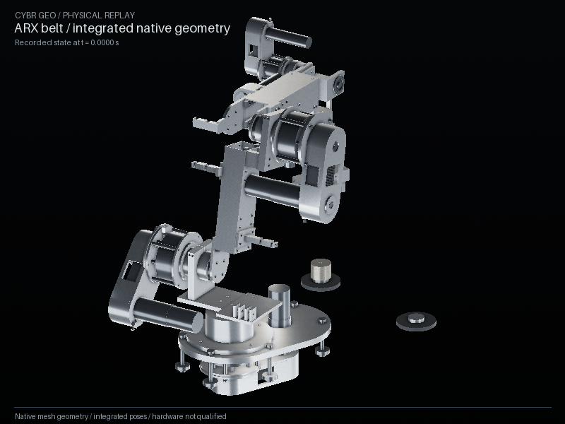
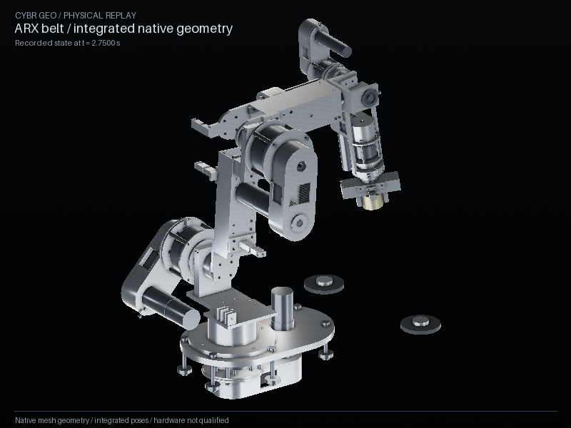

# Actual nominal motion under the authored transfer policy



This is the complete **17.4-second nominal task**, with 41,760 actual MuJoCo
integration steps. The authored policy retains the source TCP path, forward
tool tilt and wrist roll, sets lateral tool tilt to zero, and uses a validated
reference clock to slow transfer and descent. The controller drives simulated
actuators; neither the clock nor this renderer assigns physical body poses or
attaches the free workpiece to the gripper. The fresh nominal run passed
placement at B with **0.209 mm** error and return placement at A with
**0.0945 mm** error.

This evidence uses the pinned ARX belt P5 source at `aabdf8c57a4ee64f77b8a246ad9aca7b51d9cba2`; P5 is not the latest ARX revision, and this packet does not establish integration or validation of newer source.



The rendering uses freshly constructed native geometry, bound to recorded body
states through the existing replay service. No source film, image generation,
prescribed body animation or interpolated motion supplies the pixels. At
800 × 600 and six requested frames per second, the GIF displays **106 selected
recorded states** across the complete cycle. Its **17.57-second playback**
includes the final 0.17-second display hold. The saved simulation has 2,089
states at 120 Hz; images hold those states rather than generating extra poses.

The [native replay check](replay-check.json) independently compares 62,900
transformed vertices across five recorded poses, checks exact cache rebinding
and validates the CAD attached to all 385 displayed parts. The
[native readback](native-readback.json) reopened 392 valid positive-volume STEP
solids and 385 GLB components. These are geometry and recorded-motion checks,
not a continuous clearance proof.

The [media manifest](media-manifest.json) binds the exact trace, model,
reference, native receipt, source closure, clock implementation, rendering
script and output files. [Frame metadata](replay-evidence.json) records each
selected integration state, camera and GIF duration. The model identity begins
`7e2d0955`, the reference identity begins `0cc503e8`, and the native source
binding begins `f7c1923e`. The receipt also records the corrected causal runtime
(`1c06bfd2`), clock implementation (`d5f6a666`), and exact authored policy.
Full SHA-256 values are in the manifest. The prior ten-second packet in
[`../arx-engineering`](../arx-engineering/README.md) remains separate historical
evidence. The rejected earlier 17.4-second policy is documented separately in
[`diagnostic-17.4s`](diagnostic-17.4s/README.md); its motion does not supply this
packet's pixels or acceptance evidence.

[Media inspection](media-inspection.json) verifies all 16 manifest file hashes,
the exact rendering script, all GIF frame durations and the nonblank stills.
Five lift, transfer, placement and final-return stills were also visually
inspected for framing, visible workpiece location and rendering defects.

This GIF depicts the nominal case. It does **not** demonstrate emergency payload
retention. Ordinary fault runs and adverse controls have separate measured
reports. Hardware, supplier fits, belt pretension, fatigue, thermal duty and the
complete articulated BREP motion envelope remain unqualified.

Display limitations remain explicit: four deforming spring coils, flexible
cables and the workbench surface are omitted, while their declared force/contact
models remain active. Internal shafts, pulleys, pinion and belt teeth retain
native local phase because separate material/rotor states were not recorded.
The puck's visible bore is not present in its declared cylindrical contact
proxy. Surface finishes are source appearance rather than measured materials.

After installing the documented environment, reproduce from the repository
root using a **new empty output directory**:

```sh
python .github/scripts/check_default_engineering.py --output outputs/engineering-arx-core-final --timeout 1800
python docs/pr-assets/arx-faults/render_media.py --run outputs/engineering-arx-core-final --out outputs/arx-final-replay
```

The first command constructs the public default, integrates its complete task,
exports CAD and performs independent readback. The second verifies the saved
source identities and invokes the maintained native replay checks and renderer.
It requires a supported graphics context; setup and backend limits are in the
[platform guide](../../PLATFORMS.md). It has no operating-system-specific paths
or alternate physics implementation.
