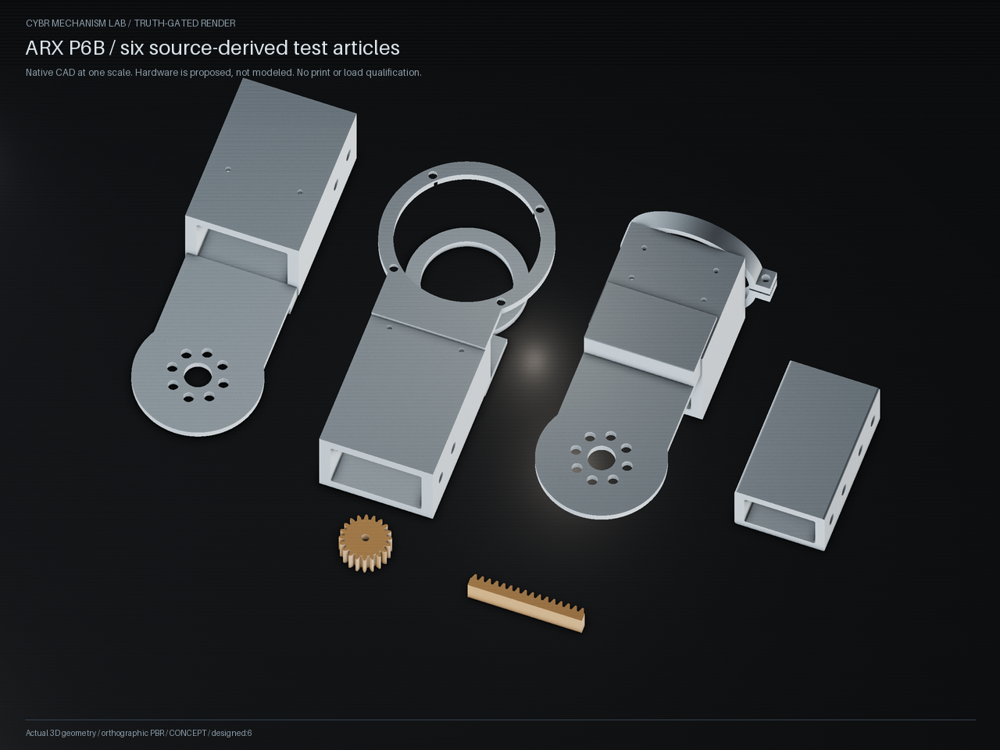

# P6B shared construction: native test-article evidence

This packet records six source-derived CAD test articles produced through
`manufacturing_joints`, `manufacturing_gears` and the existing
`NativeConstruction` service. The source is
[`cybr-arx6-compact` at `85bd6d2ce5b7c567d08b3ffccf2a9be46005aabf`](https://github.com/cybrdelic/cybr-arx6-compact/tree/85bd6d2ce5b7c567d08b3ffccf2a9be46005aabf/revisions/p6b-print-first).
The actual Refined upper/fore BREP inputs and their source identities are
retained in the example's data directory.



The PNG is an actual shared VTK geometry render. Its `cybrgeo_evidence` metadata
contains the source input hashes, native-build receipt hash, specification
digest and six display-only translations. The parts are shown at one scale.
Colors aid inspection; they do not establish PETG optics or a printed finish.

## What was checked

The focused native suite passed **24 tests** on Windows; its exact runtime is
recorded in `parity.junit.xml` and `test-run.json`. It
executes the unchanged original structural builder in isolated output, using
the verified input BREP bytes, then compares the shared implementation's four
structural solids by volume, center of mass, inertia, analytic bounds and
bidirectional Boolean difference. It also checks:

- Native validity and STEP round trips for all four structural parts.
- Six native parts, six placements and the assembled three-part upper joint.
- Actual plate-local STL surface volumes and plate offsets for all six parts.
- Shared native mass integrals and every recorded output hash.
- Nondefault construction and rejection of invalid walls, pockets, split
  positions, coupled sleeve dimensions, bore patterns and source frames.
- The nominal sleeve/M4 candidate fit and corrupted-input rejection.
- A large inner-corner-radius edit that would close the captive-nut pocket.
- Code-hash mismatch rejection, and unchanged native results when temporary
  input paths change after their verified byte snapshots were captured.
- A `181 mm` planning cube that fits the raw longest part but fails its actual
  `185.85 mm` occupied extent after the required `5 mm` plate placement margin.

The measured split distance is `0.299999999999983 mm`; both sleeve mate
distances are `0.199999999999996 mm`. All three native intersections have zero
volume. These are nominal CAD measurements. The report's `1e-6 mm` distance
allowance is a kernel comparison allowance, not a manufacturing tolerance.

`test-run.json` records the exact command and observed terminal outcome.
`parity.junit.xml` is the raw generated JUnit report; its host label was set to
`local-validation-host` at emission to avoid publishing the machine hostname.
No test result was edited. The single warning is CadQuery's assembly `save`
deprecation. Gear/source parity has a
separate suite in `tests/test_manufacturing_gears.py` and is not counted among
these 24 tests. The preview was subsequently rendered and its PNG metadata
and image hash independently read back.

`independent-readback.json` records a separate native readback process: it
reopened all six source-local and six print-local STEP files, recomputed native
mass properties and the three interfaces, and checked the current four code
hashes, recorded artifact hashes and occupied plate bounds.
The helper's machine-specific invocation log is not included in this packet.

## Reproduce

From the repository root, with the project's documented CAD/render extras
installed:

```text
python -B -m pytest tests/test_manufacturing_joints.py -q --basetemp outputs/p6b-parity
python -B examples/engineering/arx_compact/print_first.py --output outputs/p6b-native --render
python -B examples/engineering/arx_compact/print_first.py --output outputs/p6b-native --render-only
```

An editable source-derived specification is
`examples/engineering/arx_compact/data/print-first-spec.json`; pass a copy with
`--spec`. Its split, sleeve, pockets, wall and tooth parameters have coupled
construction guards. The verified BREP joint-end frames and span dimensions
are fixed; changing an entire arm's dimensions requires explicit new native
inputs. The default bore radius derives from the OD6 sleeve candidate plus
`0.10 mm` radial clearance, preserving the source `3.10 mm` radius.

The generated `cad/` directory contains native STEP/STL and the nominal upper
assembly. `print-local/` contains six STEP/STL pairs translated to individual
plate frames. The print plan reports those translations, exact native bounds,
declared density and file hashes. Native mass records use kilograms, meters
and kg m²; CAD and interfaces use millimeters.

The receipt binds the current client, `manufacturing_joints`,
`manufacturing_gears` and `native_construction` source hashes. The build
checks them before CAD and before/after receipt finalization; the preview
rechecks them. Native BREP import consumes the same in-memory bytes whose
hashes were verified, so a later path edit cannot replace an accepted input.

## Receipt scope and limits

The copied `native-build.json` and print plan are **references to the actual
generated outputs**. The complete referenced CAD, STL and tessellation files
are not bundled in this compact packet; reproduce them with the commands
above. Source identities, nominal requirements, mass records, plan, preview,
render receipts and actual input specification are bundled. `SHA256SUMS.json`
binds the packet's included bytes; `packet-verification.json` records an
independent readback, including byte equality to the original copied outputs.
`source-default-spec.json` retains the exact supplied specification bytes;
`input-spec.json` is the accepted parsed specification written by the native
builder. Their separate byte hashes and shared canonical identity are retained.

Verify the bundled packet without rebuilding CAD:

```text
python docs/pr-assets/arx-latest/print-first/verify-packet.py
```

These are four structural test articles and two separate tooth trials, not a
complete printable robot. Metal sleeves, bolts, washers, nuts and covers are
proposed hardware and are not modeled in this assembly. The inherited collar
relief changes radius `36.5` to `36.65 mm` locally; its fit remains unqualified.
The mass/inertia model assumes solid PETG at `1250 kg/m³`, without infill,
anisotropy, creep or thermal behavior. The `246 mm` planning cube is not a
successful slicing, printing or fit claim.

No whole-arm motion/dynamics, load capacity, FEA, fatigue or hardware
qualification follows from this packet. The coarser pinion/rack trials are
not drop-in gripper replacements. Appearance-only material conversions and
purchased reducer envelopes from the wider source are not treated as working
printed transmission internals. Missing P6A control/thermal implementation is
not reconstructed or claimed here.
