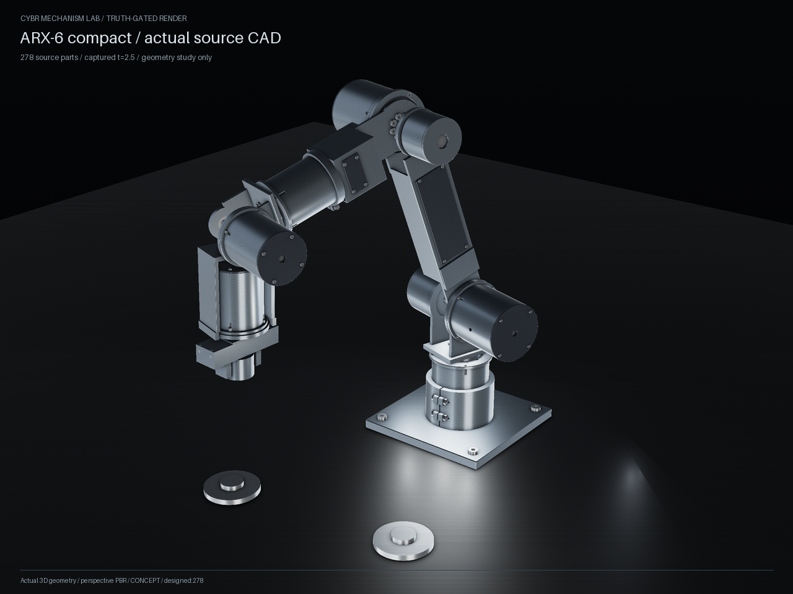

# Actual Refined native geometry



This packet uses compact source commit `85bd6d2ce5b7c567d08b3ffccf2a9be46005aabf`: all
278 part records, 123 explicitly bound body-local BREP replacements and 155
CSG evaluations. The image is the actual generated assembly at saved frame
300, t = 2.5 s. It is a static placement from the archived capture;
the changed geometry has no new dynamics acceptance.

The public CLI completed successfully. Construction, export and property
reconciliation took 151.35 s; the native
render took 7.36 s. Independent readback reopened all 278
STEP files as valid native geometry and checked 278 GLB nodes. It preserves
the source-method reconciliation of all 123 changed parts and separately
checks their exchanged volume, mass, CoM, inertia and bounds. Readback took
50.48 s. All 97 focused tests passed.

The homogeneous-density geometric mass change is
`-0.00491667060450564 kg`. Inherited assembly mass
overrides and tensors are retained unchanged; this delta does not replace
them or qualify changed-body dynamics. Source coils 263 and 269 retain their
two solids, and part 263 retains its authored-bound overrun. Component and
reducer envelopes do not expose supplier internals. No new clearance, fit,
load, thermal, fatigue, production or hardware acceptance is claimed.

## Reproduce

```sh
python -m examples.engineering.arx_compact.refined --output outputs/arx-refined --render
python .github/scripts/check_latest_arx_geometry.py --check-existing --only refined --refined-output outputs/arx-refined --output outputs/arx-refined-readback --timeout 600
```

The CLI constructs the artifacts. The second command independently reopens
them and explicitly records `constructed_fresh: false`; it does not claim a
second construction. CI uses the helper's default fresh-construction mode.
The source bundle contains exact raw byte hashes and upstream paths, while
the reports bind source inputs, resolver/DAG/recipe/integrator code and CAD
artifact bytes. Foreign output-writing source modules are never imported.

## Preserved failed attempt

The first public run failed reconciliation after 220.95 s. All 123 refined
BREP comparisons passed, but original CSG parts 100, 132 and 168 exceeded the
existing `1e-12 kg m²` absolute tensor tolerance. Inspection showed that
upstream explicitly cleans each single original solid before integration.
Applying that exact source normalization to the original comparison fixed
the three residuals. Acceptance tolerances were unchanged. The raw failed
reports are preserved losslessly in `failed-first/`; their original hashes
and the explicit diagnosis are retained. They are not relabeled as success.

The subsequent interrupted attempt produced no files and no completed
result. The accepted run used a fresh output directory after the environment
was restored and the lost process outcome was checked.

A completed intermediate run is preserved under `superseded-pre-final/`.
Final review then found that cached display tessellation could perturb
reported bounds, and that source hashes read only at report time could
mislabel code edited during construction. The final fresh run uses analytic
BREP bounds without triangulation and captures the explicit resolver, DAG,
mass integrator and client identities before work, rejecting source drift.
The intermediate success is not substituted for this final accepted run.

## Native exchange and integration methods

The first independent STEP readback failed on part 272's off-diagonal inertia:
the default kernel integration differed by about `1.0052e-11 kg m²`, above
the existing `1e-12 kg m²` absolute comparison tolerance. The source BREP and
STEP both remained valid single solids with 78 faces; cleaning the STEP did
not fix the discrepancy. This failure is preserved in `failed-first-readback/`.

The final readback separates two numerical contracts. First, the original
source integration convention must reproduce archived BREP properties at
the existing tolerances. Second, STEP exchange is compared to its verified
source BREP using the same adaptive Gauss integrator for both, with requested
relative errors `1e-14` and `1e-15`. Both native and STEP convergence checks
pass, and all 123 exchange comparisons pass the unchanged property budgets.
The largest native-versus-STEP tensor difference is `6.35e-13 kg m²`.

The adaptive and archived/default methods are **not numerically equivalent**
for source parts 2, 32, 66, 100, 132 and 168: the largest measured differences
are about `0.6062723 mm³` volume, `1.63694e-6 kg` mass and `9.17213e-10 kg m²`
tensor. The reports retain both conventions and their residuals. Source
archive agreement is not an assertion of that archive's absolute integration
accuracy. The source-method geometric mass delta above is preserved, and
adaptive exchange masses are labeled separately. No mass-core behavior,
archived values, acceptance tolerances or earlier dynamics evidence changed.

See [normalization diagnosis](normalization-diagnosis.json),
[native readback](refined-readback.json), [test results](refined-geometry-tests.xml)
and [byte manifest](manifest.json). A manifest is an integrity receipt,
not a signature or proof of physical buildability.
