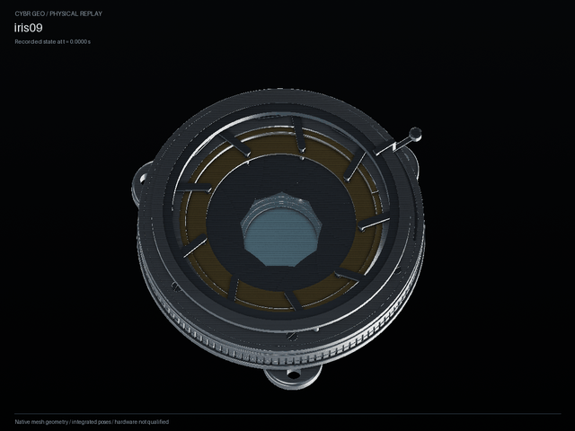

# IRIS-derived single-motor engineering evidence



This is the new single-motor linkage derived from IRIS-09's optical geometry,
built and simulated through CYBR GEO's shared engineering services. One annular
motor drives nine bored rods and nine passive leaf shafts. The images use all
68 generated native CAD components at saved MuJoCo body poses. They do not use
the original shader film, prescribed follower animation or generated imagery.
The original source geometry study remains a separate example and evidence set.

The final public run is `outputs/engineering-iris09-core-final`, with freshly
constructed CAD in its own `native/` directory. Its model identity begins
`a983eaf6`, and its native source binding begins `8517812e`. The [manifest](manifest.json),
[native build](native-build.json) and [complete native source binding](native-source-binding.json)
retain exact identities and distinguish raw file hashes from canonical JSON
identities. The final media was rendered anew from this actual run using the
current portable capture script.

The [separate runtime comparison](runtime-parity.json) records that all 954
complete saved frames exactly match the preceding accepted run. It retains
both runtime and model identities; it does not treat the old simulation as a
new execution. Its [executed comparison script](compare_trace_states.py) uses
exact canonical JSON values without rounding or interpolation.

## Measured behavior and causal controls

The eight-second nominal cycle passed its declared task requirements over
40,000 integration steps. Every-step loop closure stayed below 0.000000373 mm;
maximum ring tracking error was approximately 0.000634 rad. The passive leaves
reached the aperture endpoint within 0.000205 rad and stayed within the
constructed 0–0.9 rad interval. No body wrench or independent follower force
was imposed. These are measurements of the declared ideal-pin model, not
manufacturing tolerances. See the [measured requirements](engineering-summary.json).

The [portable causal-control runner](run_causal_controls.py) was actually
executed for two further eight-second, 40,000-step runs:

| Run | Observed result | Task result |
| --- | --- | --- |
| Motor power disabled from initialization, same model | All nine leaf excursions remain below 1e-10 rad | Fails |
| First rod closure disabled from initialization | Leaf 0 stays at rest; the other eight reach about 0.899847 rad | Fails |

The first case demonstrates that motor input is needed for motion; it is not an
emergency-stop or loss-of-power holding test. The second case is a changed-model
numerical counterfactual with unchanged CAD.
It does not describe an alternate hardware assembly. The [case results](counterfactuals.json)
and [independently checked trace bindings](counterfactual-trace-bindings.json)
preserve the actual model, native, control, reference, runtime and executed
runner identities. The failed tasks are the expected causal contrast.

## Native geometry and clearance scope

[Independent readback](ci-readback.json) verifies 230 native artifact hashes,
68 parts/placements, 102 declared interfaces, 74 valid positive-volume solids
in the aggregate STEP, and 68 GLB geometry nodes. The shared axial construction
retains a 0.2 mm moving-pin/lower-lip gap and a 0.1 mm keeper/radial-bearing gap.
Those two conservative planar envelope checks apply throughout the declared
travel, only to their named mating pairs.

The [full-assembly native audit](native-clearance.json) evaluates nine actual
recorded poses, with 2,103 cross-body part pairs per pose. It uses conservative
bounding boxes, native BRep distances and intersection checks. The sampled
minimum gap is 0.014893 mm, with no material intersections. Its original
source/model identity is retained. The separate
[exact geometry/pose bridge](clearance-equivalence.json) connects that audit
to the final accepted run: every registered/placed STEP input, local frame,
placement/material record and all 954 saved body poses/times match exactly.
All 136 registered/placed STEP DATA sections match. Of the 20 aggregate STEP
exports, ten match and ten differ only in 189 explicitly listed presentation
entities. The differing raw and DATA hashes are retained; no aggregate
byte-identity claim is made.

This remains a finite sampled whole-assembly audit. It does not prove a complete
continuous articulated clearance envelope. A [preserved failing earlier audit](pre-repair-clearance-failure.json)
records the output-pin/lower-lip interference that led to the shared axial-stack
construction. It has a different model identity and is not the published media's
geometry. The [load-path review](load-path-review.md) details support and
retention assumptions.

## Images and replay checks

[Start](start.png), [midpoint](pose.png) and [top](top.png) show the opaque native
assembly. The [linkage inspection view](linkage-inspection.png) adds explicitly
labeled rotor transparency to reveal the rods; geometry and poses are unchanged.
Its [display override record](linkage-inspection.json) names each affected part.

The GIF holds 65 actual states selected from the 954 saved frames. It is resized from 1120 × 840 to
640 × 480 with every frame duration preserved. There is no interpolated joint
animation. [Media metadata](media.json) records exact frame indices, times,
camera, timing and output hashes. The total playback is 8,120 ms: the eight-second
simulated cycle plus a 120 ms final-frame hold.

[Native replay checks](replay-check.json) compare every mesh vertex at five
recorded poses, retain valid analytic CAD, and check exact cache rebinding.
All 2,081,655 vertex comparisons match exactly; native CAD/mesh bounds differ by
at most 0.001441 mm.
[The Three.js check](three-replay-check.json) loads the actual final GLB and
compares transformed vertices with independently evaluated SI solver poses.
Its 1,020 comparisons differ by at most 0.000003626 mm, within float32 mesh precision.
These are programmatic checks; no live browser UI was available for verification.

The source's 0.0325 mm foil is treated as rigid. Foil stiffness, buckling, hub
attachment, fabrication tolerances, retainer installation, wear, fatigue and
hardware suitability remain unqualified. The direct-drive motor and material
values are explicit assumptions. Ideal pin constraints do not solve local
bearing contact or validate a supplier motor. See the
[example documentation](../../../examples/engineering/iris09/README.md) for
source attribution and the retained original geometry-study command.

## Reproduce

From the repository root with CYBR GEO installed, generate a fresh public run:

```sh
lab mechanism iris09 --out outputs/iris09-proof --step
python docs/pr-assets/iris-engineering/capture.py \
  --run outputs/iris09-proof --out outputs/iris09-proof-media --full --inspection
python docs/pr-assets/iris-engineering/run_causal_controls.py \
  --run outputs/iris09-proof --out outputs/iris09-proof-controls
```

The capture reads the native directory from the run's receipt. Use `--native`
only if that verified artifact directory was relocated. It imports current
native STEP and meshes, replays saved states and checks source identities; it
does not run another simulation. The selected high-angle views are output-only
inspection choices.

The capture script includes a Windows cross-drive receipt-path fallback.
The published media was rendered with this exact script SHA256:
`05ef398d0f18fae31fab62a92adf985a519dbe55e188c5672278b634b8b76a53`.
The manifest records that execution separately from source, runtime and native
artifact identities.

After installing Studio's dependencies as described in its source README:

```sh
node studio/web-auth/probe-native-replay.mjs \
  outputs/iris09-proof-media/native-three-fixture.json \
  outputs/iris09-proof/assembly.glb outputs/iris09-proof-media/three-replay-check.json
python docs/pr-assets/iris-engineering/clearance-audit.py \
  --native outputs/iris09-proof/native \
  --trace outputs/iris09-proof/simulation/trace.json.gz \
  --out outputs/iris09-proof-clearance --times 0 1 2 3 4 5 6 7 8
```

That last command directly audits the newly generated run. The published
equivalence bridge is retained for its specific historical-to-final input pair;
it is not a substitute for checking a changed mechanism.
