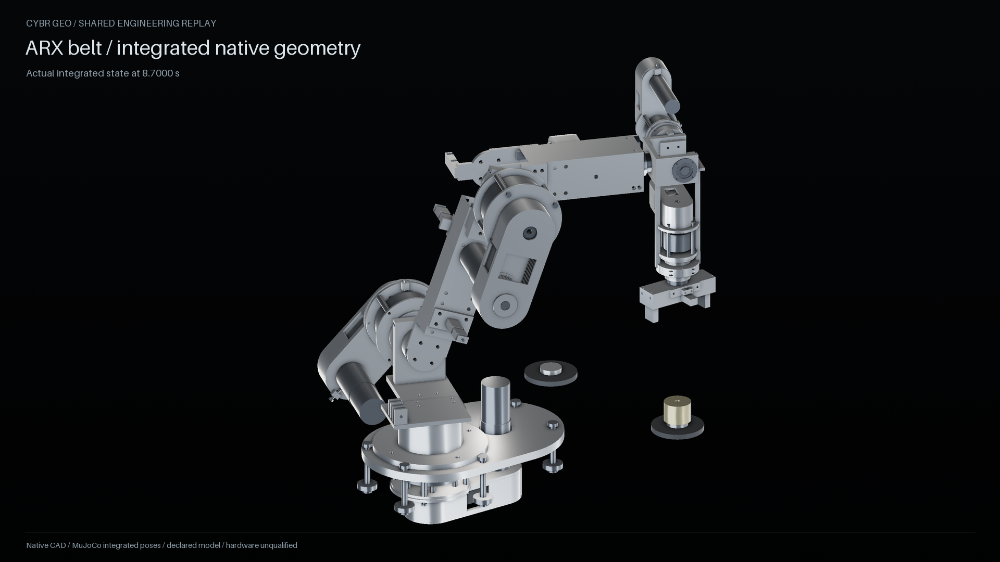
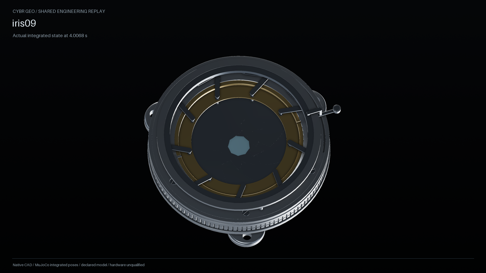
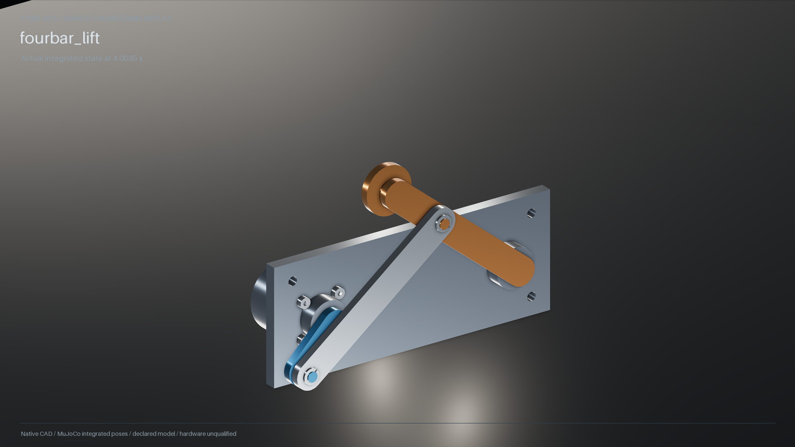

# Shared engineering replay evidence

These images and films were rendered from native CAD at integrated simulation states by the reusable `native_replay.build_assembly` and `physical_replay.build_assembly` services. Both builders were observed once per capture; `RecordedMotion` held the verified body states. The footage was captured from clean source commit `451e86fb204698eaa34d283621422aa042e5bebf` at 1920 × 1080, 24 fps and 2× supersampling. Frames and media were generated by the repo renderer from actual geometry and trace data; no image generation was used.

| Client | Inspected still | Full motion | Recorded simulation | Native geometry |
| --- | --- | --- | --- | --- |
| ARX belt | [Actuated pose](arx-actuated.png) | [17.4 s, 419-frame MP4](arx-motion.mp4) | Six electrical drives and contact-driven independent puck | 118 parts, 380 placed components |
| IRIS-09 | [Actuated pose](iris-actuated.png) | [8 s, 193-frame MP4](iris-motion.mp4) | One drive, nine passive leaf/rod closures | 68 placed components |
| Four-bar lift | [Lifted pose](fourbar-lifted.png) | [8 s, 193-frame MP4](fourbar-motion.mp4) | One drive, passive coupler and gravity-loaded rocker | 15 placed components |

[Library delivery manifest](library-manifest.json) has all nine confirmed image/video IDs and hashes. Capture records: [ARX metadata](receipts/arx-media.json) and [frame map](receipts/arx-frames.json), [IRIS metadata](receipts/iris-media.json) and [frame map](receipts/iris-frames.json), [four-bar metadata](receipts/fourbar-media.json) and [frame map](receipts/fourbar-frames.json).

Each MP4 was decoded and checked for its full frame count. The original media receipts and per-frame hashes are retained in the task evidence; the exact binaries here match the Library deliveries. ARX film SHA-256 is `c070a239eb1fc081fc8ce599aa2c91dbc6d2705df68fb51aa2c8a79c7f1f409e`; IRIS is `1adf478742c2e16752633e3e6b499136cbe4109b86e5d5ea6632ae19eb7b7cbd`; four-bar is `4193d29784135c21f0905f23b6facebe7fce831e5f24b6fb7a908860f5c4e44e`.

These captures are diagnostic engineering evidence. They show modeled kinematics and scoped dynamics; they do not certify material lots, manufacturing capability, inspected fits, continuous collision clearance, fatigue, or hardware load capacity. The later manufacturing release path checks separately for revision-bound physical evidence. No current example has that evidence.
