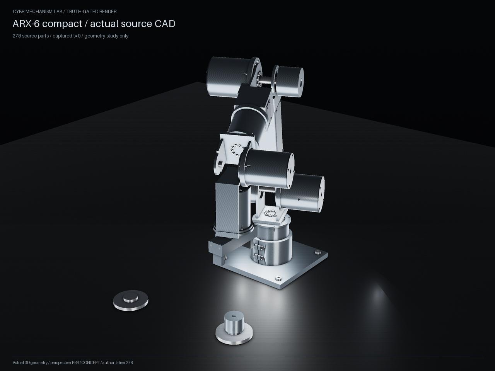

# ARX-6 compact source geometry

This example evaluates all **278 authored compact parts** with GEO's shared
`ShapeEvaluator`, including both helical springs. It is a separate design from
the belt-drive example. It creates analytic CAD at the actual source capture's
first pose; it does not run or reconstruct the source's cinematic controls.

From the repository root, in the environment installed with the CAD extra:

```powershell
python -m examples.engineering.arx_compact.design --output outputs/arx-compact-reference --render
```

An installed wheel also includes the example. Resolve and run its maintained
script with `mechanism_lab.engineering_source.project_directory`:

```python
import runpy
from mechanism_lab.engineering_source import project_directory
runpy.run_path(str(project_directory('arx_compact') / 'design.py'), run_name='__main__')
```

The output includes `reference.step`, `reference.glb`, individual body-local
STEP files, the shared content-addressed `shape-dag.json`, and
`geometry-study.json`. With `--render`, the PNGs come from the actual CAD mesh
using GEO's renderer. The report records every source part, validity, solid
count, volume, authored versus actual bounds, source status, and artifact hashes.
Native construction can take several minutes; progress prints every 25 parts.
To rerender the saved, hash-checked GLB without repeating CSG evaluation, pass
`--render-only` with the same `--output` directory.



The geometry is explicitly unqualified. Supplier reducers and bearings are
interface envelopes, not internal CAD. No mass, inertia, clearance, operating
load, contact force, dynamics, motion envelope or physical assembly acceptance
is inferred from the CSG. Source `mass_override_kg` values remain in the pinned
input but are not promoted to CAD mass measurements.

The source-native spring geometry has defects which this example preserves:
parts 263 and 269 each contain two disconnected solids. Part 263 extends to
local Z = 92 mm although its authored bounds end at 74 mm. An independent run
of only the pinned native builder's `build()` function confirms these results;
see `evidence/spring-native-source-receipt.json`. These findings are not repaired
or hidden by the shared evaluator. The generated report may reveal other
disconnected records or authored-bound overruns.

`assets/design.json` is copied byte-for-byte from
[`cybrdelic/cybr-arx6-compact`](https://github.com/cybrdelic/cybr-arx6-compact/tree/0003382bd6a2e96f3bed065003efec35001982f7)
at commit `0003382bd6a2e96f3bed065003efec35001982f7`.
Its SHA-256 is
`48b3dcf993f78a9e1f386c8458644bb5829d627c895b88e58e616ae14aa565a0`.
The native operation semantics come directly from `source/build_meshes.py`
(SHA-256 `1b2e4f087634f8ff41ad450195a2a35ef3ef6445d1bc25efbad9c797f7fb2e50`).
No separate compact geometry generator is embedded here: its `op/args/children`
records feed the same core used by other examples and legacy component plans.

`data/initial-pose.json` contains only the exact first frame extracted from the
source `assets/capture.json` (SHA-256
`ba938e6a1e0a829c52435a5ef165e7364bf8cb072a604bb18ff0577edf6f1b33`).
The extracted pose JSON is also pinned byte-for-byte with SHA-256
`d8cbe609a96572e99030c152cce89a726a2e681efc2ff97ce651e0a24bb07e07`.
Body-local shape lengths are millimetres; captured translations are metres and
are multiplied by 1000. The final right-handed coordinate change is
source `(x,y,z)` to GEO `(x,-z,y)`. Missing or nonrigid body frames are rejected.

Reuse follows the user's explicit instruction to adapt their CYBR sources.
No additional upstream project-wide license is asserted. Source attribution
and these limits remain with the example; GEO's existing license is preserved.

Focused checks:

```powershell
python -m pytest tests/test_arx_compact_geometry.py tests/test_shape_dag.py
```
