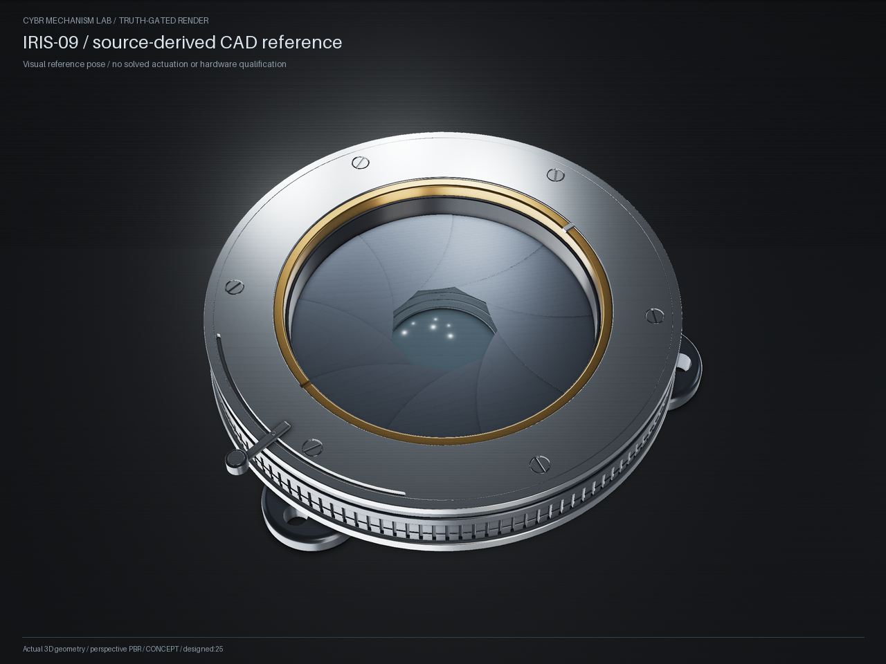
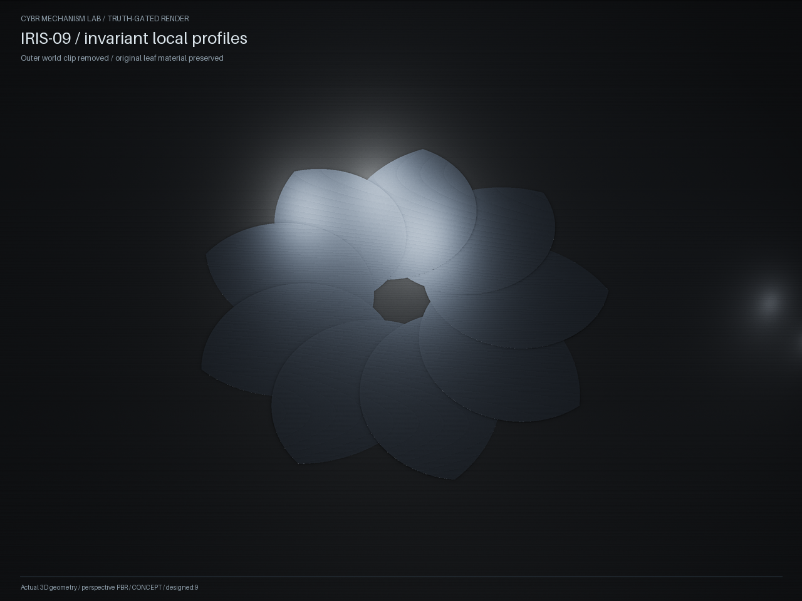

# IRIS-09 source geometry study

This example constructs the actual IRIS-09 source's nine-leaf geometry and housing features with CYBR GEO's shared `ShapeEvaluator` and `NativeConstruction` services. It exports analytic CAD at a defined reference pose. It is a geometry study; it has no mechanical acceptance gate or physics model.



From the repository root, with CYBR GEO installed:

```sh
python -m examples.engineering.iris09.design --output outputs/iris09-reference --time 5 --scene-unit-mm 50 --render
```

The installed wheel includes the same maintained example. It can also be run
through the installed example locator (normal CLI arguments still apply):

```python
import runpy
from mechanism_lab.engineering_source import project_directory
runpy.run_path(str(project_directory('iris09') / 'design.py'), run_name='__main__')
```

The command writes STEP, STL, GLB, actual-CAD PNG views, a shared leaf DAG, source hashes, and `geometry-study.json`. Native artifacts and their hashes are recorded in `native-build.json`. Rendering uses the existing GEO renderer, without source images, image generation or an alternate shader renderer.

The reference pose is **t = 5 seconds**, hinge angle **0.45 radians**, actuator angle **0.16 radians**. The source formulas repeat after 20 seconds, although its published film covers one ten-second half-cycle. Changing `--time` rebuilds a display snapshot; it does not simulate the mechanism.

The source declares scene units without a physical conversion. The default **50 mm per scene unit is an explicit example assumption**, giving a leaf vertical thickness of 0.0325 mm. The source's `cant` is a dimensionless slope. Material colors and densities are illustrative assumptions recorded in each build; they are not material specifications or measured mass properties.

## Exact source geometry and explicit limits

[source-geometry.json](source-geometry.json) identifies the originating lines, constants, source commit and SHA-256 hashes. The source is [`cybrdelic/cybr-iris09` at `6aac7159`](https://github.com/cybrdelic/cybr-iris09/blob/6aac71594c211cc5934674b2113d9db8c5ec17c6/IRIS-09.glsl). This example directly transcribes:

- Two intersecting circular leaf profiles and the exact canted slab, including the distinction between vertical and normal thickness.
- Nine hinge placements and the source's prescribed leaf/actuator angle formulas.
- Fourteen rounded radial housing profiles, 120 grip flutes, the annular seam, two spanner notches and the curved actuator slot.
- Three bored mounting ears, six recessed slotted screw heads, and the handle, pivot and cap.
- Two closed plano-convex optical volumes, using the source sphere/plane equations.

The thumb knob uses the source's mean radius. Its omitted 28-lobe knurl has radial amplitude 0.0025 scene units, or 0.125 mm at the default scale. Shader grain, engraving, wear, the zero-thickness sensor surface, lighting and refractive appearance are outside this CAD example. Material partitioning preserves the housing's occupied union while avoiding duplicate volume accounting; it does not establish physical assembly interfaces.

## A rigid leaf is different from the displayed clip

The source clips every moving leaf against a stationary world cylinder. That changes the amount of displayed material as the hinge angle changes. This example keeps the distinction in its artifacts:

- `cad/invariant_leaf_template.step` contains the complete, invariant two-circle/slab leaf in its local frame.
- `cad/visual_reference_subassembly.step` and `reference.glb` contain the separately clipped source display at the chosen pose.
- `cad/unclipped_profiles_reference_subassembly.step` and `invariant-profiles.glb` show all nine invariant profiles at their prescribed reference placements, before world clipping.
- `leaf-shape-dag.json` expresses both constructions through the same shared evaluator. `geometry-study.json` records their sampled volumes and explicit body frames.

At the default scale, the invariant leaf volume remains about **230.238 mm³**. The displayed clipped volume changes from about **77.265 mm³** at t=0 to **55.389 mm³** at t=5 and **41.628 mm³** at t=10. These are actual CAD measurements that demonstrate why display clipping cannot be used as rigid-body mass or inertia.



The authored hinge positions are mathematical placement frames. The source does not supply hinge pins, a solved pin-slot linkage, actuation closure, a validated torque path, contact dynamics or an established tolerance model. This example adds none of those claims. The source's sampled-clearance comment is not transferred into evidence. Neither geometry checks nor the images establish physical buildability.

## Verification and attribution

```sh
python -m pytest tests/test_shape_dag.py tests/test_iris09_geometry.py
```

Tests compare actual CAD point membership with the source's circle/plane equations, frame placement with its hinge basis, volume with analytic annular-profile and spherical-cap formulas, and invariant versus clipped leaf volumes. The supplied evidence images are rendered from this implementation's generated geometry.

The pinned source package supplies no upstream license grant. Its use here follows the owner's request to adapt the source into CYBR GEO; no upstream license grant is invented and no original shader or media files are redistributed. The new adaptation follows CYBR GEO's existing GPL-2.0-only licensing.
